# UI pass plan, Ekotehnika storyline 2

The working plan for the UI, motion and illustration pass. Every item points at a screenshot of what is there now,
what Filip said about it, the references he sent or that came from the site scans, what to do, what not to do, the
numbers to build to, and how to check it. Builders work from this file and from nothing else.

Sources. Filip's notes in `notes.md` (refs 01 to 06, scan items 8 to 23, scene notes S1 to S12), the Linde rules
in `brand-rules.md` (guideline pages in brackets), the taste log `studio/clients/ekotehnika/taste.md`.

## 0. Ground rules

- **The storyboard timeline does not change.** `src/story2/timeline.ts` keeps 12,000px and the 15 beats H, D1, C1,
  D2, F, R, Z, P, A, B, S, L, N, T, AT with their spans, hold beats and order. Only what is drawn and laid out
  inside a beat changes. Sections after the pinned story (statement, products, clients, closing, footer) are
  normal page sections and may be added or rebuilt.
- **Lead version is 5 Sistem.** The new UI lives in the shared shell, so versions 2 and 4 get it too and keep their
  own scenes, adjusted only for framing (part E).
- **Baseline** that must not regress is commit 926a2b7, live at https://ekotehnika-hero.vercel.app/?v=5. Its
  frames are in `refs/current/`.
- **Settled by Filip on 2026-10-12.** No white frame and no box around the logos. The Linde FF Dax web licence is in
  place, so the brand font goes on the site. Ekotehnika gave permission for a client logo wall. Every other default
  in the earlier decision list stands (sans serif only, servis stays dark with no red on it, official red
  `#A00020`, no calculator, giant automatizacija word replaced, photos stay in Proizvodi, no play button, no Always
  on your side claim).
- **Writing.** Serbian Latin, sentence case, headlines benefit first, no commas or dashes in headlines, a full stop
  only on a full sentence (p.45). Copy only from `copy.ts` sources, new lines marked dummy.
- **Never.** No CSS filter, invert or blend on the canvas. No line icons on product beats. No centred kicker, title,
  box and equal card stack. No white rounded caption cards. No empty third of the frame. No storyboard frame traced
  one to one. All of these are rejected in the taste log on 2026-10-12.

## Part A, the system

Builder 1. Files `src/ui/HeroFrame.tsx`, `src/ui/heroframe.css`, `src/story2/shell/*`, `src/story2/copy.ts`,
`src/styles.css`, `public/fonts/`.

### A1. Type, Daxline Pro

The Drive holds `DaxlinePro` in Light 350, Regular 400, Medium 500, Bold 700 and ExtraBold 750, converted to woff2
in `ekotehnika-hero/public/fonts/daxline/`, all with č ć š ž đ. The guideline names Dax Pro for headlines and
Daxline Pro for small digital text (p.13). Only Daxline is in the Drive, so it carries both until Filip sends Dax
Pro files.

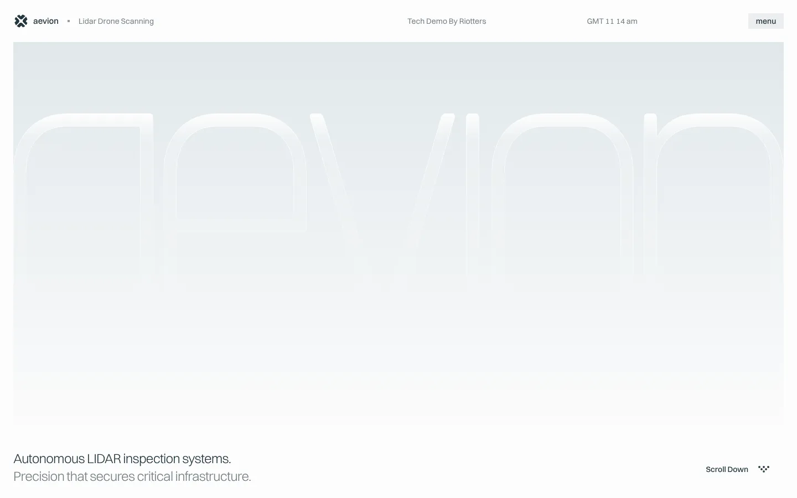
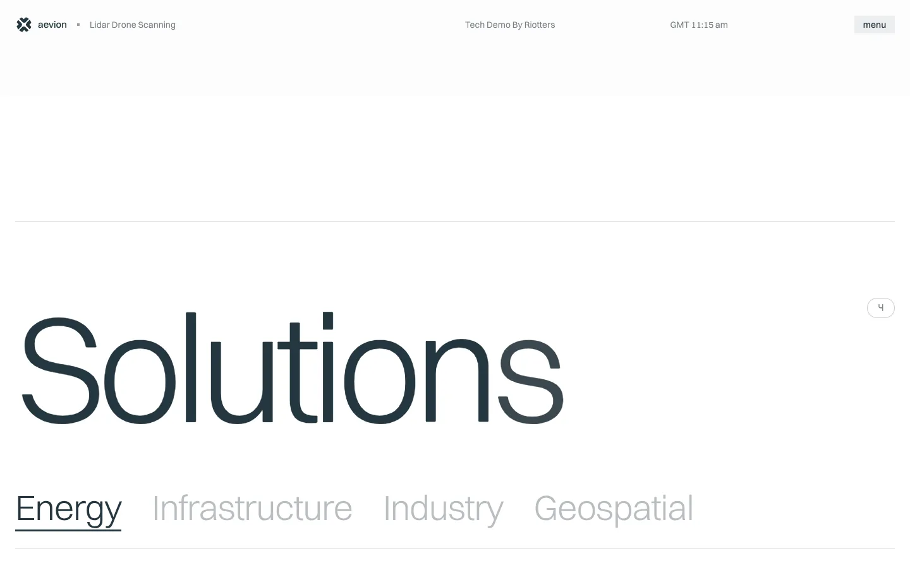
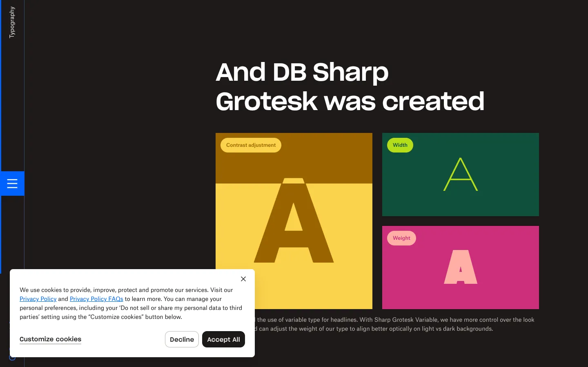

- **Do.** One family across the site. `@font-face` in `src/styles.css`, `font-display swap`, preload Regular and
  Light. Display titles Light 350 at clamp(96px, 11vw, 200px), tracking -0.04em, line height 0.9. Section titles
  Regular 400 at clamp(56px, 6vw, 96px), tracking -0.03em, line height 0.95. Lede Regular 400 at 24px, line height
  1.35. Body Regular 400 at 18px, line height 1.5. Labels Medium 500 at 14px uppercase, tracking 0.08em, in place of
  Geist Mono (14px is the README accessibility floor). Figures in spec rows Light 350 at 56px with tabular figures.
- **Don't.** No serif. No Geist, Geist Mono, Fira Sans or Google Fonts left on story2 routes (remove the Google
  Fonts link from `index.html` once nothing on the live routes uses it). No all caps titles. Nothing under 14px, labels
  included.
- **Check.** Computed font family on h1, h2, p and a label is Daxline Pro, and the network panel shows no Google
  Fonts request on `/?v=5`.

### A2. Colour

- **Do.** Tokens in `src/styles.css`. `--lmh-red #A00020` for the filled primary button and nothing else in the UI.
  Text `#000000` on light (p.14). Greys from the LMH set only, pale `#e9e9e9` for fields, light `#d2d2d2` for
  hairlines, medium `#a1a1a1` for the unfilled scroll text and captions on white only when large, dark `#6b6b6b`
  for secondary text. White `#ffffff` ground. On the dark servis beat, ground `#0b0b0b` to `#141414`, text white,
  lines white at 30 percent.
- **Info colours** (blue `#468cc4`, turquoise `#7fbccd`, green `#a4c778`, yellow `#ffdb70` at 72 percent) only inside
  the servis schematic and the spec tables, one at a time, never on UI chrome (p.14).
- **Don't.** No `#aa0020`, `#990e1f`, `#cc132a`, `#94001d`, `#700016`, `#ba1926` on story2 routes. No red on the dark
  beat (p.14). No warm mid grey bands (S1).
- **Check.** grep the story2 shell and the sistem scene for the retired reds, zero hits. Contrast measured on real
  pixels, body 4.5 to 1, titles 3 to 1.

### A3. The grid

Filip, note 5. "I like placement of UI against a grid on the website - it adds to flavor and makes it look like
geometric." He also said the R screen had "No grid on this page".

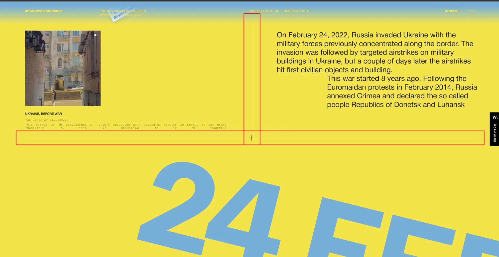
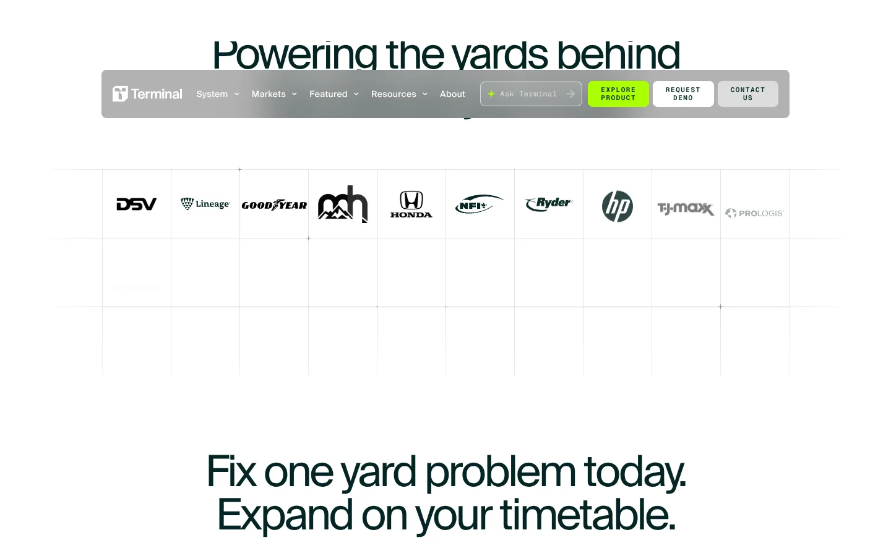
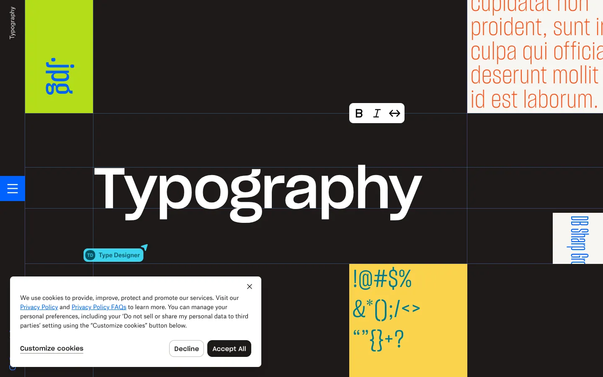
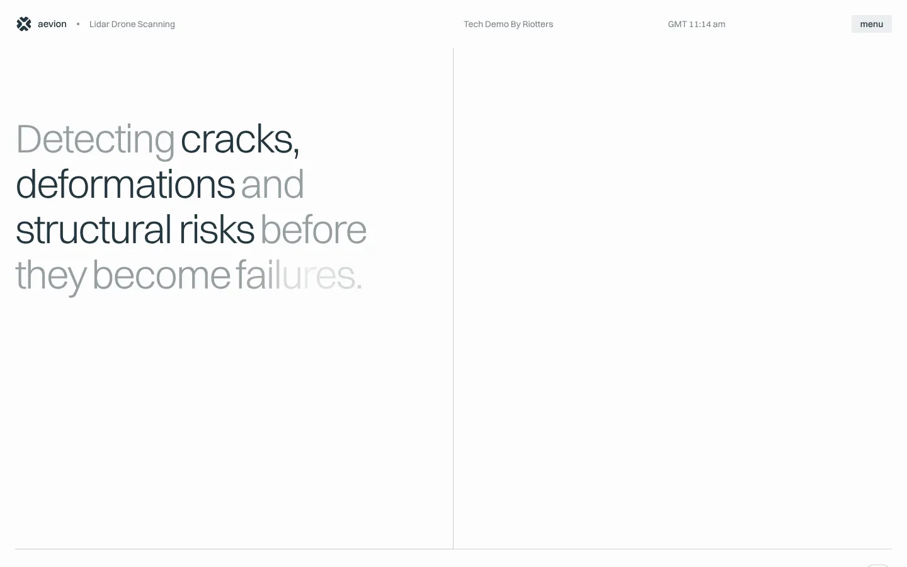

- **Do.** A fixed 12 column grid over the whole story, 48px outer margin at 1440, 24px gutters, drawn as 1px
  `#d2d2d2` vertical hairlines on columns 1, 4, 7, 10 and 13 (edges and thirds) plus one horizontal rule under the
  top row at y 136 and one above the bottom at y 836. A 9px plus mark in black at every crossing. On the dark beat
  the same lines in white at 18 percent. Every text block, figure cell and button starts on a column line. A
  small mono style coordinate label in the bottom left (for example 44.66 N 20.44 E, Vrčin, marked dummy) as flavour.
- **Don't.** No lines through text, the grid layer sits under the text and over the scene, and lines are masked
  behind text boxes with a 16px padding. No grid on Proizvodi, statement or footer sections beyond their own cell
  hairlines.
- **Check.** Every hold beat at 1440 shows text and buttons starting exactly on a column line (measure left edges).

### A4. Top row and logo

Filip, S2. "I don't like the fact the logo is boxed up", "Poorly executed button design". On 2026-10-12, no white
frame either.

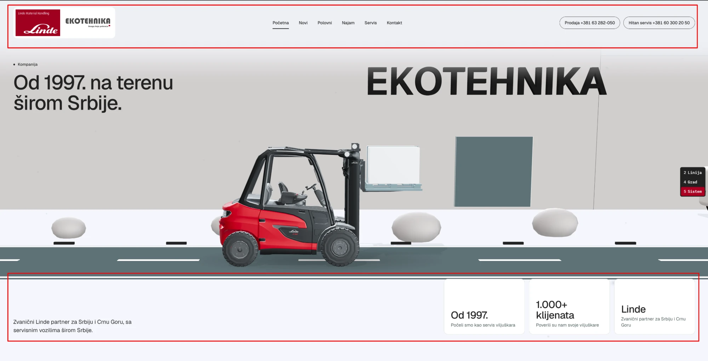

- **Do.** Logos straight on the ground, top left at x 48, y 24, the Linde Material Handling block at 160 by 96px and
  the Ekotehnika wordmark exactly 160px wide beside it, 30px apart (3x, p.8, p.11), from `public/brand/*.svg`.
  Nav links centred on the grid's middle column, Medium 500 at 15px, active link with a 2px underline that draws on.
  Right side, two secondary buttons (Prodaja, Hitan servis with the numbers) and one primary (Zatražite ponudu),
  spec in A5.
- **The dark beat.** The guideline bans the Linde logo on dark grey (p.12) and Filip ruled out a box. So from pos
  7790 to 9525 the two logos fade out over 200ms and back in after, the nav and buttons stay. My call, flagged in
  the report.
- **Don't.** No white tile, no frame, no shadow, no recolour of either logo (p.5, p.12). No logo over a photo.
- **Check.** Logo boxes measure 160 by 96 and 160 wide at 1440, no element behind them but the plain ground.

### A5. Buttons

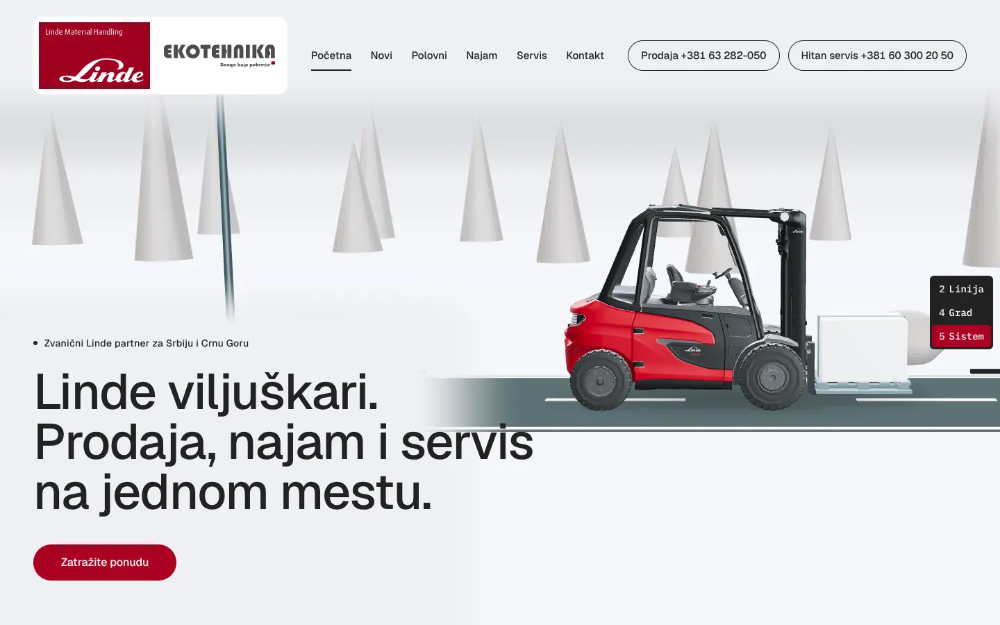

- **Do.** Height 48px, radius 4px, padding 0 20px, label Medium 500 14px uppercase tracking 0.1em. Primary filled
  `#A00020`, white label, on light ground only. Secondary filled `#e9e9e9`, black label. On the dark beat the primary
  becomes white with a black label. A small arrow glyph after the label on primary buttons. Hover is a block wipe
  of a darker fill from left to right in 240ms, focus a 2px black ring with 2px offset.
- **Don't.** No 1px outline pills, no fully round pills, no red on dark.
- **Check.** Every button on every beat uses one of these three styles, measured.

### A6. Data rows instead of cards

Filip, S4 "Bad cards", S6 "The UI execution again bad", S9 "Really bad UI/UX, layout, everything here".

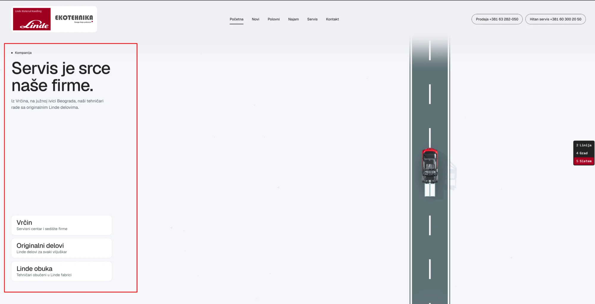
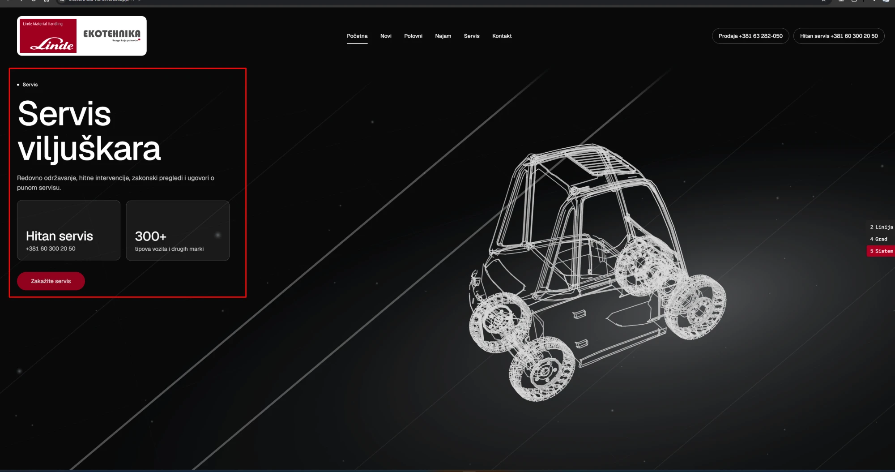
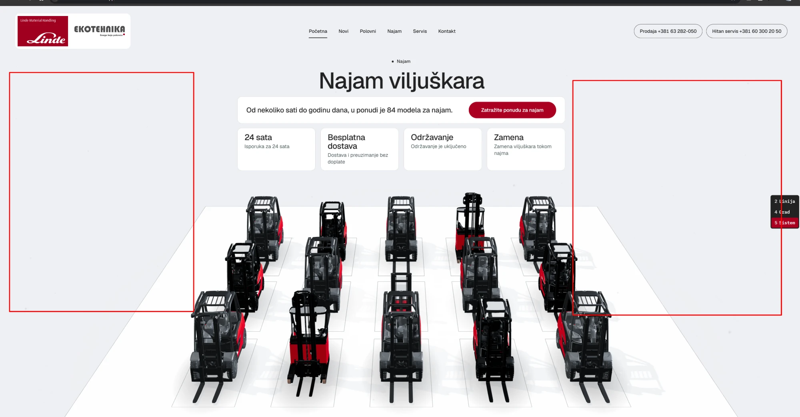
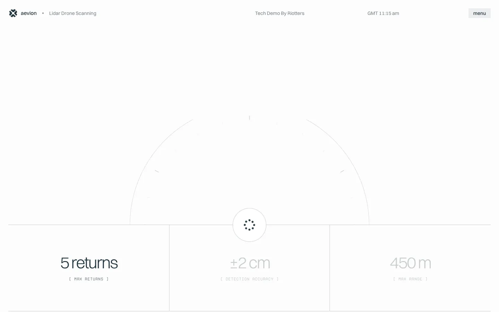
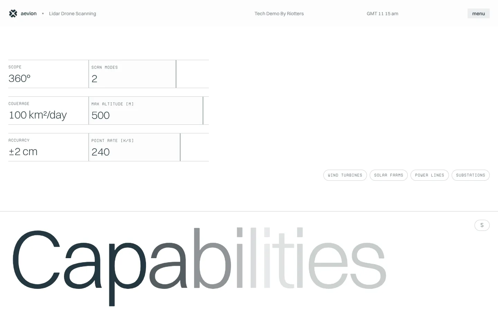
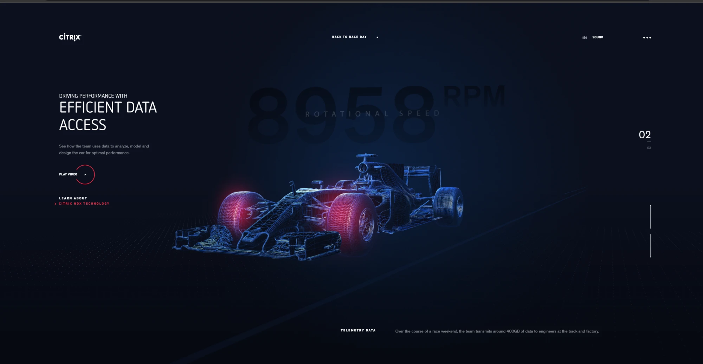

- **Do.** Facts are a spec row, cells divided by 1px `#d2d2d2` hairlines that sit on grid columns, each cell a figure
  in Light 350 at 56px and a 14px uppercase label under it, 24px inner padding, no fill, no radius, no shadow.
  Longer facts use a two line cell, a label and one sentence at 18px. Figures count up (B3).
- **Don't.** No white rounded cards, no glass tiles, no equal width boxes centred in the frame.
- **Check.** No element with a border radius above 4px on any hold beat.

### A7. Section markers and progress

- **Do.** Each hold beat's kicker becomes a marker, a 28px circle with the beat number (01 Kompanija, 02 Kompanija,
  03 Prodaja, 04 Servis, 05 Najam, 06 Automatizacija) and the section name in the 14px label style. On the right
  edge, a counter (current over total) and a 1px vertical progress line that fills with the story clock.
- **Don't.** No dot kickers.

## Part B, motion

Builder 1, same files as part A. All motion reads the story clock, so it scrubs with scroll and freezes with `?at=`.

### B1. Block wipe on titles

Filip, note 1. "I like this version of text reveal animation but styled for us yeah color wise".

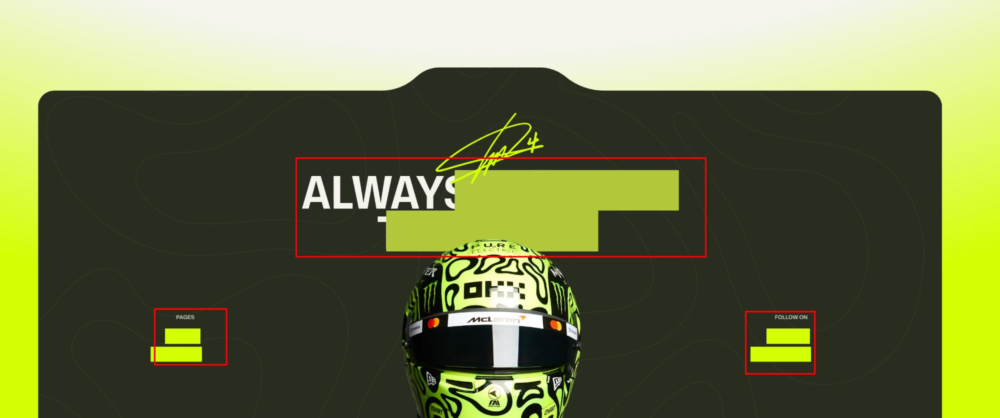

- **Do.** Each title line sits in a mask. A solid bar the height of the line slides in from the left over 0.35 of the
  reveal, then off to the right while the text shows, 0.6s per line at normal scroll speed, 80ms stagger, easing
  cubic-bezier(0.7, 0, 0.2, 1). Bar black on light beats, white on the dark beat. Same on the hero headline at load.
  Labels and buttons reveal the same way, smaller.
- **Don't.** No red bars (red is for the primary button only). No fade and slide up as the main reveal.

### B2. Scroll fill text

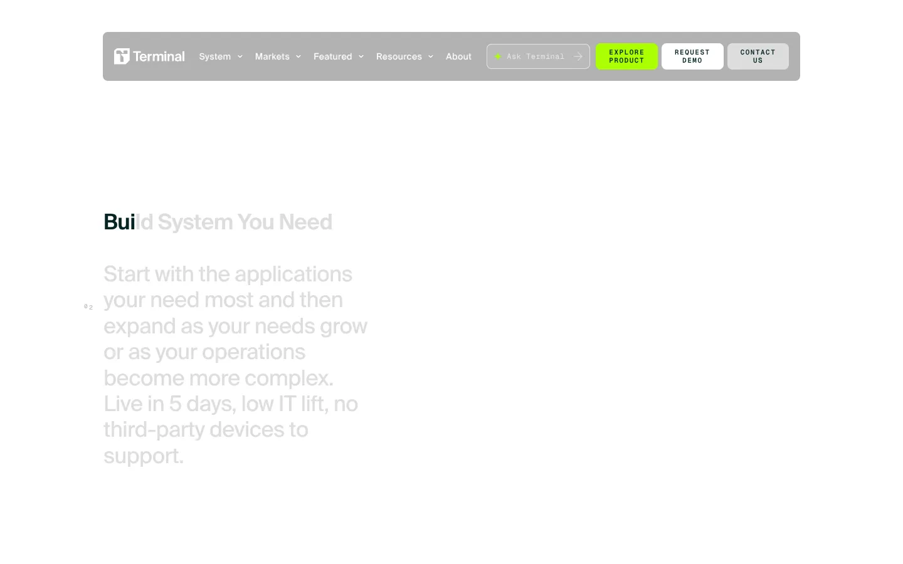
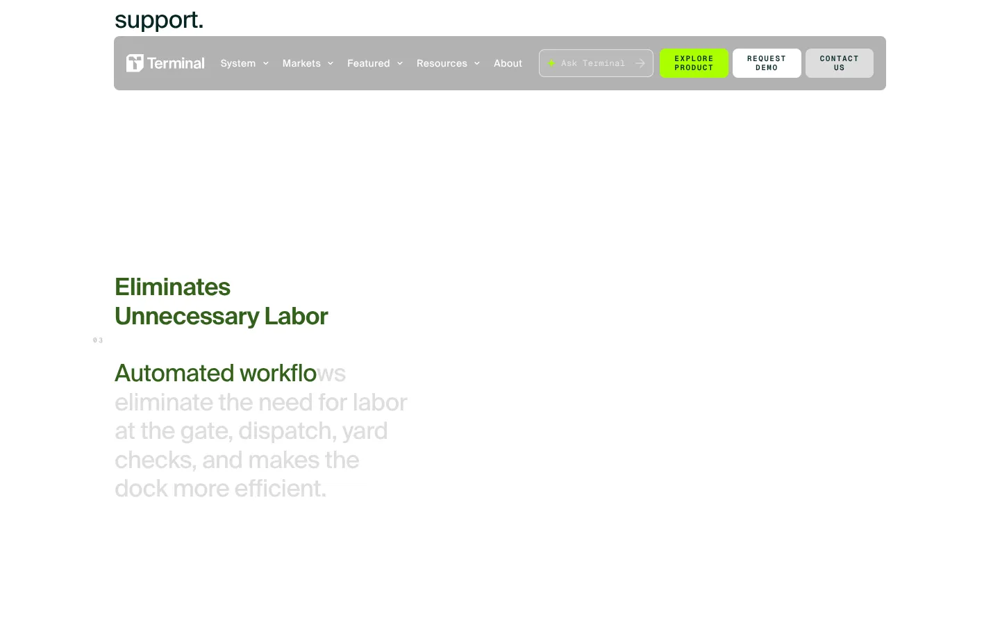

- **Do.** The lede of each hold beat starts in `#a1a1a1` and fills to black letter by letter as k runs from 0.1 to
  0.55 of the beat. On the dark beat it fills from white at 25 percent to white. Split into words then letters with
  spans, keep the text selectable and readable by screen readers as one string.
- **Don't.** No opacity fade of the whole paragraph.

### B3. Figures count up

- **Do.** Spec figures count from 0 to their value over 0.8s as their cell reveals, tabular figures so the width
  holds, ease out. Text values (Linde, Vrčin) reveal with the block wipe instead.

### B4. Grid draws on

- **Do.** At each hold beat the grid lines draw from the plus marks outward over 0.4s and dim to 40 percent between
  holds. Plus marks rotate 90 degrees once on reveal.

### B5. Notched section edges

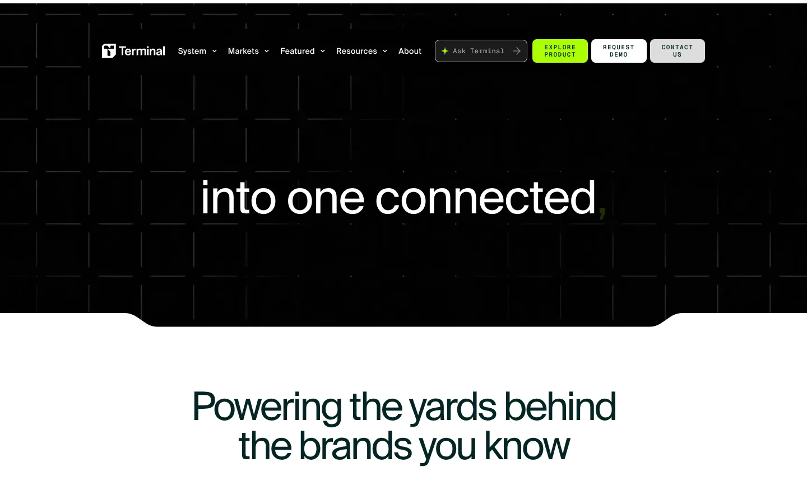

- **Do.** Where the pinned story hands over to the next section, and into the footer, the edge is a straight line
  with one wide tab notch 320px wide and 40px deep with 24px radius corners, the next section slides up under it.
  SVG path, no images.

### B6. Hover, focus, cursor

- **Do.** Links get an underline that draws from the left in 200ms. Buttons get the wipe from A5. Product items in
  Proizvodi lift their image 8px and swap the label to the model count. Visible focus on everything.

### B7. Reduced motion

- **Do.** With prefers-reduced-motion every reveal shows its end state, no wipes, no count, no fill, the story shows
  its still sections as today.

## Part C, beat by beat

Each beat lists what is there now, what Filip said, the references, what to do, what not to do and the scene
changes. Layout by builder 1, scene by builder 2 (`src/story2/scenes/sistem/*` only). Spans unchanged.

### H, hero

- **Now.** Kicker, three line headline, red pill, the forklift on the road, white cone trees and a pole behind.
- **Do, layout.** Headline in Light 350 at the display size on columns 1 to 7, block wipe on load, marker style
  label above it, the primary button under it. Logo and top row per A4.
- **Do, scene.** Replace the white cones with proper low poly trees (trunk, two or three crown masses, light grey
  and white with soft shadow), the pole with a real lamp post. Bright warm light (p.18).
- **Don't.** Nothing dark behind the headline band, x 0 to 760 by y 470 to 840 stays plain.

### D1 and D2, the drive

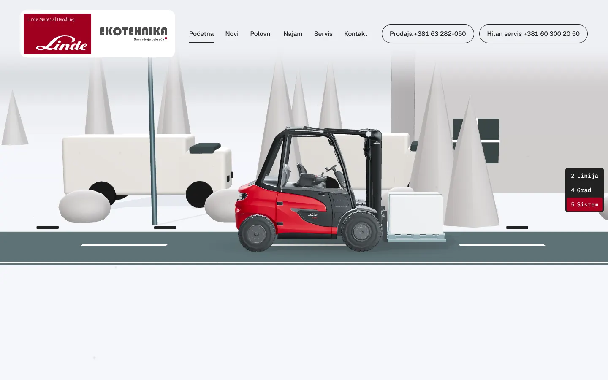
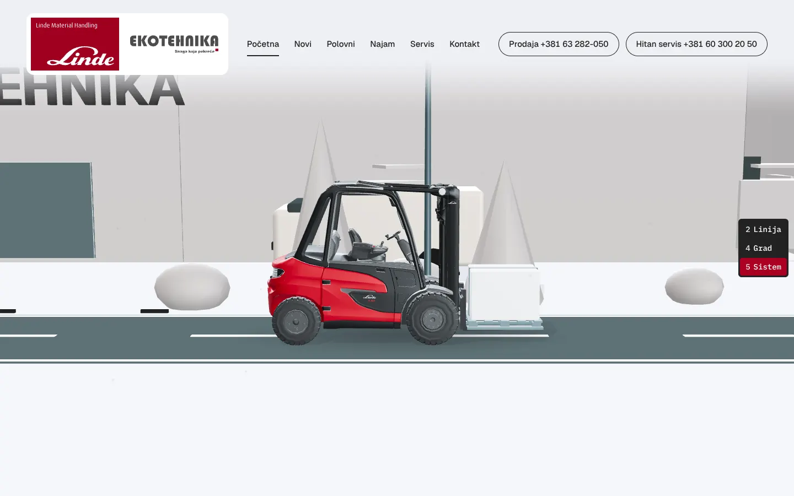

- **Do, scene.** The van gets real detail (cab, windows, wheels, an Ekotehnika livery in graphite), the egg shrubs
  become hedge and shrub forms, the building gets real windows, door and roof edge, all in white and LMH greys.
- **Don't.** No primitive blobs or cones anywhere.

### C1, Kompanija

Filip, S1 "Coloring here is bad". S2 "The empty space between the UI/animation is low, we can't clearly read the
information".

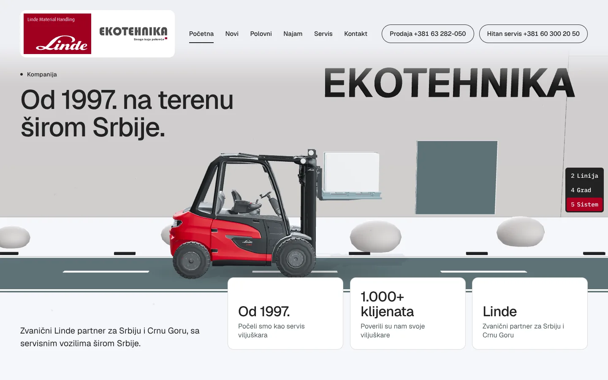

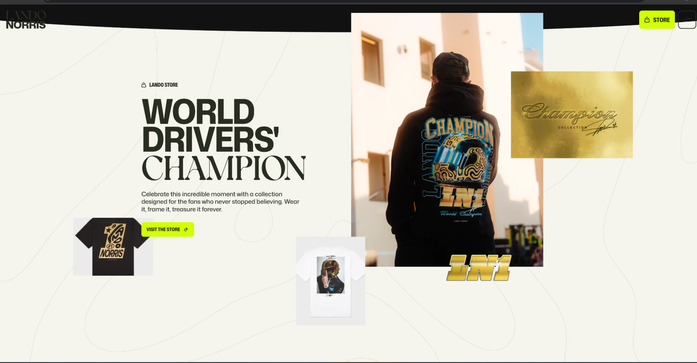

- **Do, layout.** Marker 01, title on columns 1 to 6 at the top, lede with scroll fill under it. The three facts (Od
  1997, 1.000+ klijenata, Zvanični Linde partner) as one spec row across columns 7 to 12 at the bottom, with at
  least 64px of plain ground between the scene and the row.
- **Do, scene.** The wall becomes white and `#e9e9e9` with real window bands and edge lines, the EKOTEHNIKA sign the
  only dark element, the forklift and raised load as now, shrubs as plants. The scene sits higher so the bottom
  band is plain ground.
- **Don't.** No flat warm grey band. No text touching the scene.

### F, the flip

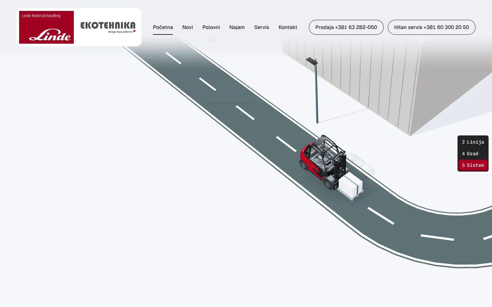

- **Do, scene.** Keep the flip. Add the yard around the path (see R) so the flip lands on a full scene.

### R, Kompanija on the path

Filip, S3 "too much empty space, we don't have anything around here on the illustration itself". S4 "This whole
UI on the left is bad", "Bad subheadline", "Bad cards", "Doesn't feel premium. No grid on this page".

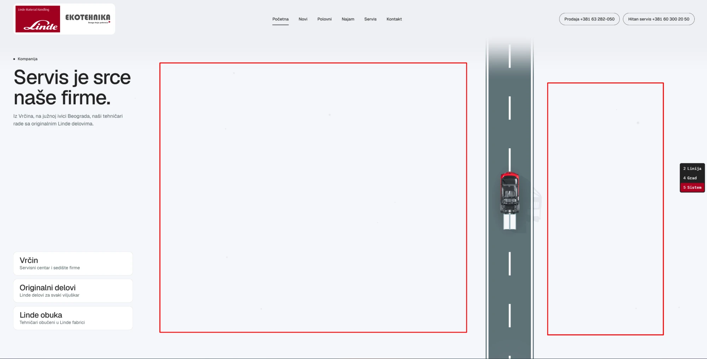

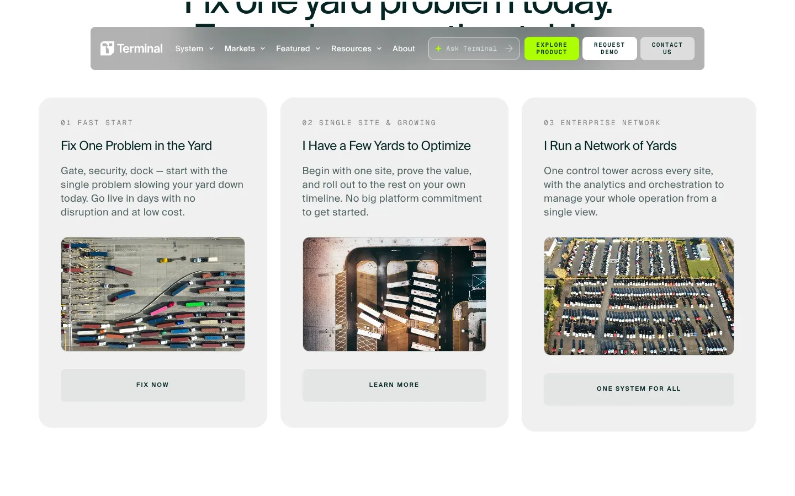

- **Do, layout.** Marker 02, title on columns 1 to 4, the lede as large scroll fill text (24px, up to five lines),
  then the three facts (Vrčin, Originalni delovi, Linde obuka) as a vertical spec list on the same columns, each a
  label and one line, hairlines between.
- **Do, scene.** The Ekotehnika yard seen from above fills both sides of the road. The two halls as roofs with skylight
  strips, rows of parked forklifts in bays, pallet stacks, racking, kerbs and lane markings, green verges and trees,
  a van at the gate. Use the drone stills in the Drive (ANDronEkotehn-1010, 1011, 1019) as layout reference only,
  never as images. Keep columns 1 to 4 plain behind the text.
- **Don't.** No empty third of the frame. No stacked cards.

### Z, the roof push

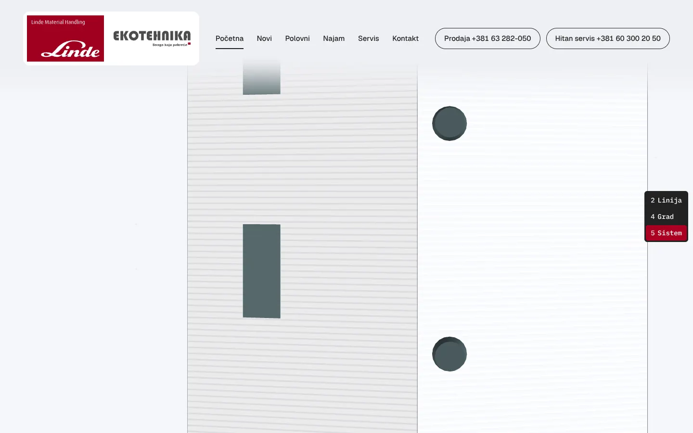

- **Do, scene.** The roof gets real detail as it fills the screen, standing seam lines, skylights, vents and a
  rooftop unit, so the push reads as a building, not two dots and a slot.

### P, Prodaja

Filip, S5 "Giga bad AI slop screen".

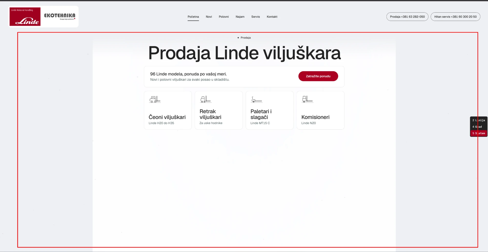
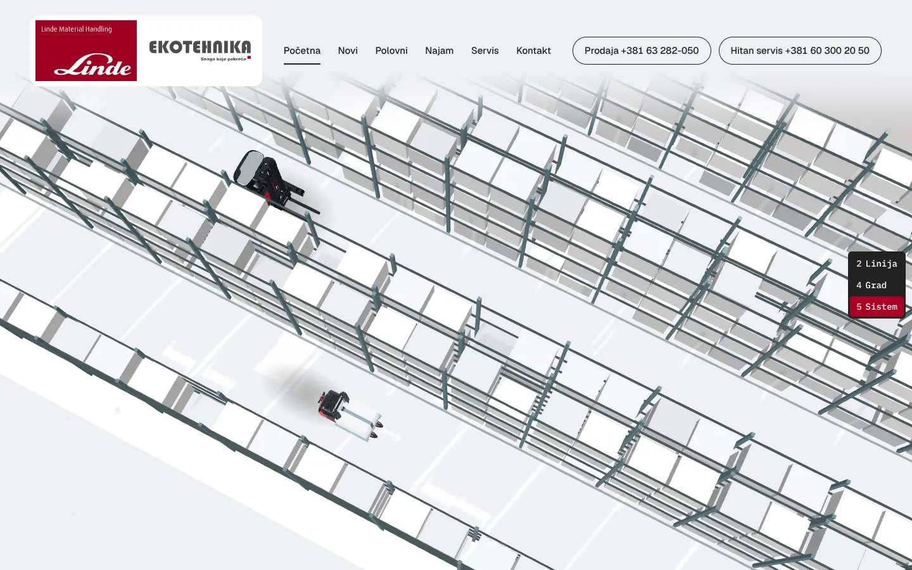
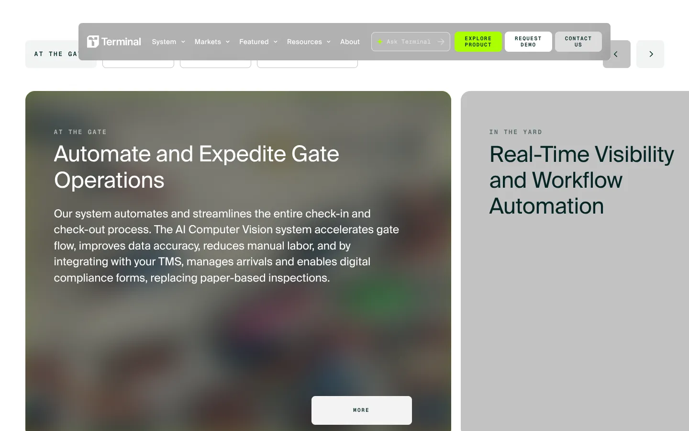
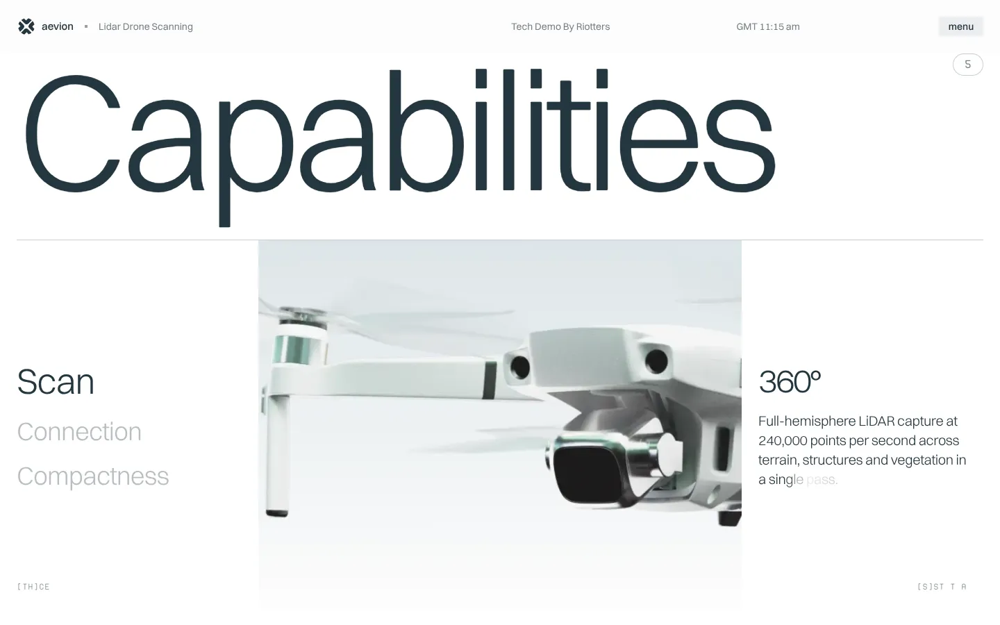
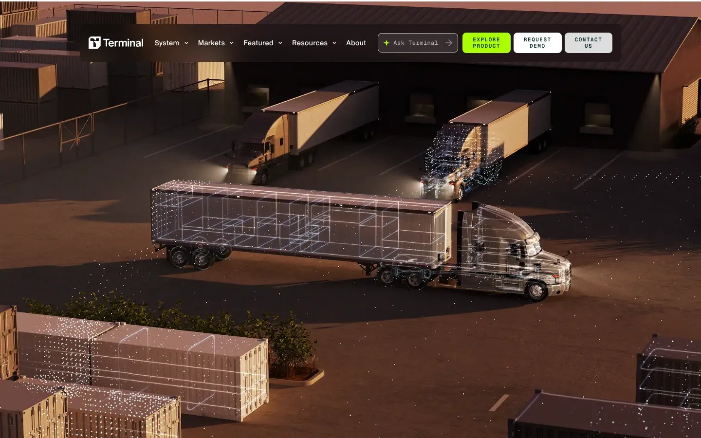

- **Do, layout.** First half of P (text up). Marker 03, title on columns 1 to 6, one line of lede (96 Linde modela),
  then four tabs in the label style (Čeoni viljuškari, Retrak viljuškari, Paletari i slagači, Komisioneri). The
  active tab shows on columns 7 to 12 a Linde cut out of that type with two callouts on hairlines (model range,
  capacity from the brief) and the primary button. Tabs switch on click and auto step with k.
- **Do, scene.** Second half of P as now (warehouse reveal), plus the T02 move, one lit truck in the warehouse with
  half of it redrawn as a precise wireframe on top, leading into A.
- **Don't.** No centred stack, no equal icon cards, no line icons, no empty lower half.

### A and B, the aisle into black

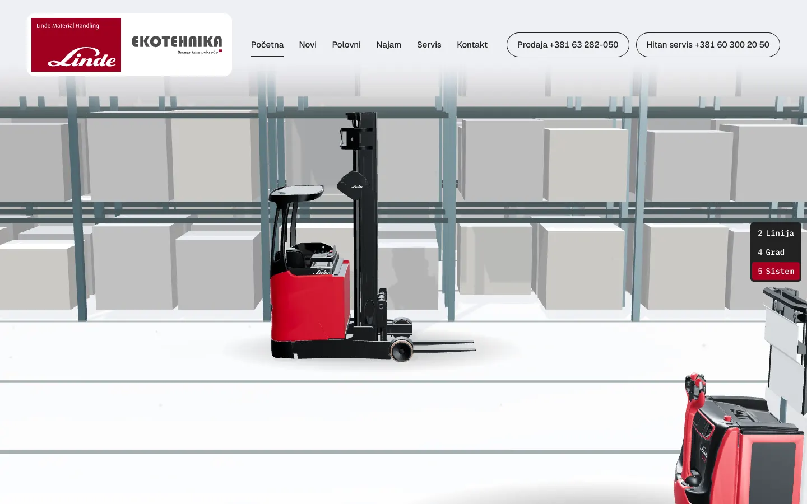
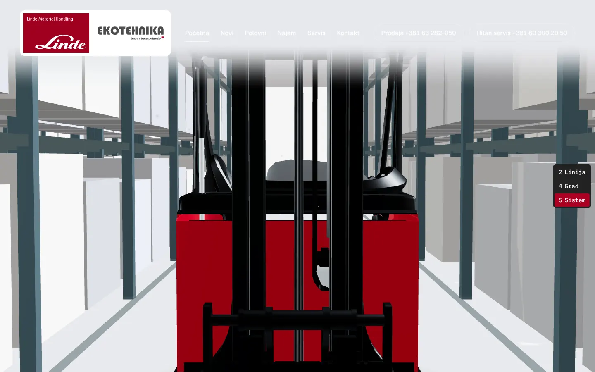

- **Do, scene.** As now. Racks get labels and beam detail, pallets get wrap and labels, so the aisle reads real.

### S, Servis

Filip, S6 "Bad UI on the left, too much space unused". S7 "feels too much hand drawn, lines not precise, doesn't
feel like a proper schematic. Schematics are really precise."

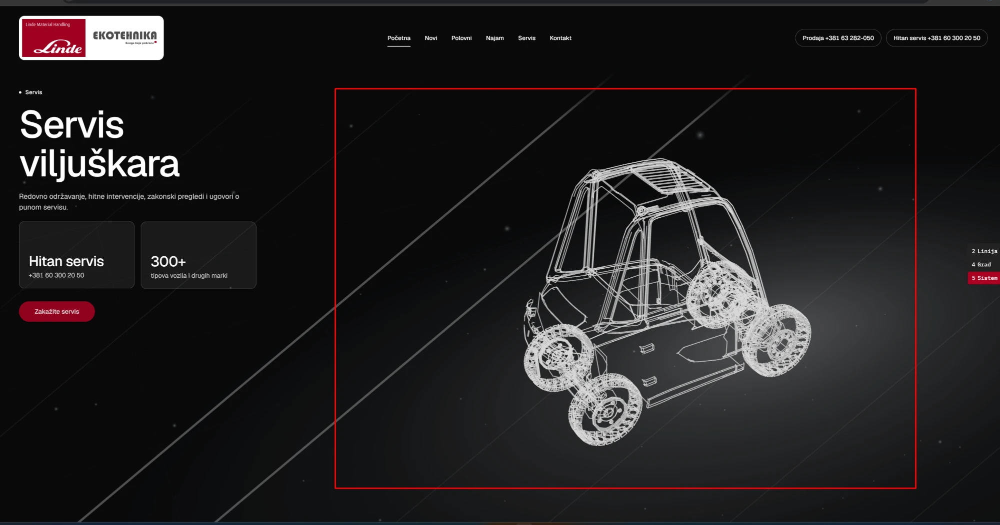

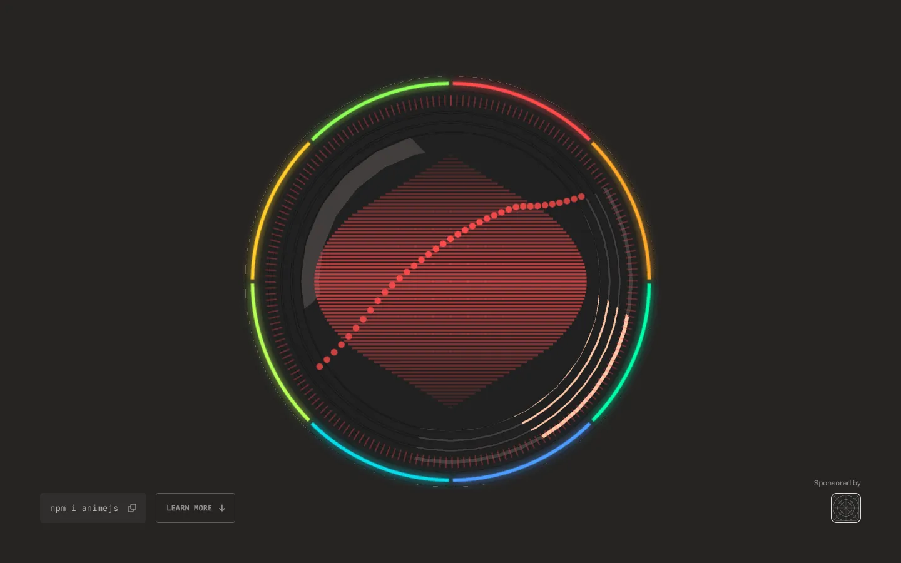

- **Do, layout.** Ref 06 almost one to one. Marker 04 and title on columns 1 to 4, lede with fill, the primary as a
  white button (no red on dark). Behind the drawing, a giant faded 300+ in Light 350 at 280px in white at 6 percent
  with its label (tipova vozila i drugih marki) spaced wide. On the right edge the counter and progress. At the
  bottom one data line, Hitan servis label and the number +381 60 300 20 50 large, linked.
- **Do, scene, the schematic.** An orthographic side elevation of the X50, centred on columns 5 to 12, at least 900px
  wide. Silhouette and key feature edges only (body outline, cab frame, mast, carriage, forks, counterweight,
  wheels with hub circles), built as 2D line geometry from the model's projected outline, not EdgesGeometry of the
  mesh. Two weights, 2px outline, 1px detail. Dashed centre lines through the wheel axes and the mast. Dimension
  lines with arrowheads and real X50 figures from the Linde data sheets in the Drive (overall length, height
  mast lowered, wheelbase), labels in the 14px style. A fine 24px measuring grid at 8 percent behind. Wheels turn
  with the clock, mast and forks shown. One info colour (turquoise 72 percent) for the dimension lines. No glow.
- **Don't.** No perspective view, no tread clumps, no glow, no red.

### L, the fork lift into najam

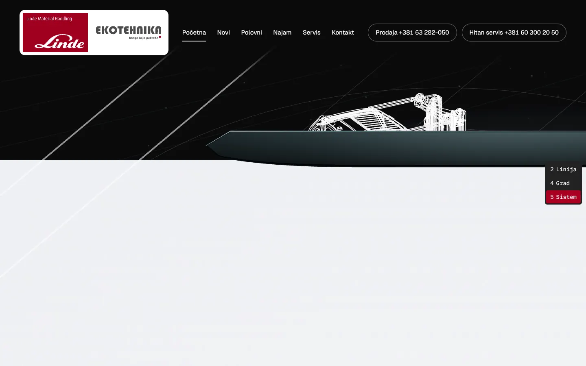

- **Do, scene.** The blade is a proper fork tine, steel grey with a lit top edge and the heel bend, so it reads as a
  fork lifting the light najam ground over the dark servis, not a black slab.

### N, Najam

Filip, S8 "Nothing here illustration wide, can be a grid or something else". S9 "Really bad UI/UX, layout,
everything here."

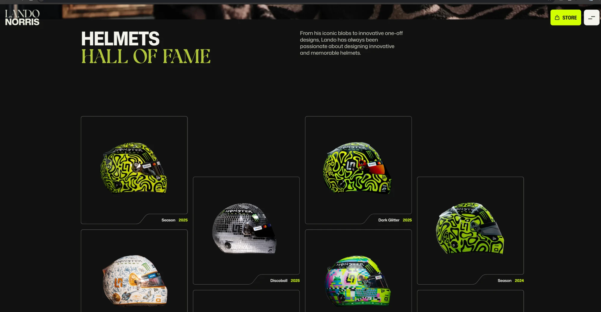

- **Do, layout.** Marker 05, title on columns 1 to 5 at the top, lede with fill (od nekoliko sati do godinu dana),
  the six facts as one spec row across columns 1 to 12 at the top band (24 sata, besplatna dostava, održavanje
  uključeno, zamena tokom najma, 84 modela), the primary (Zatražite ponudu za najam) on the grid.
- **Do, scene.** The depot floor runs edge to edge to the frame, bay lines across the full width, the fifteen trucks
  in the middle and empty marked bays out to the edges, soft shadows, a ground fade at the far edge only.
- **Don't.** No centred stack, no empty side fields.

### T and AT, Automatizacija

Filip, S10 "part of the storyboard - but taken too literally, bad execution illustration and UI wise."

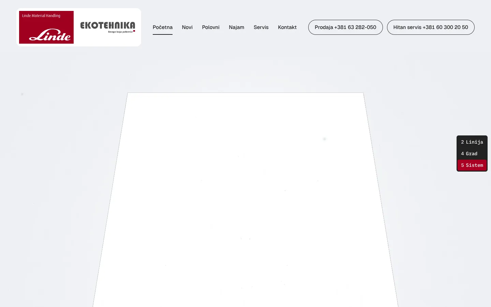
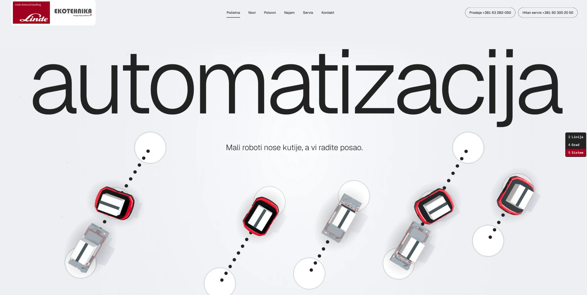

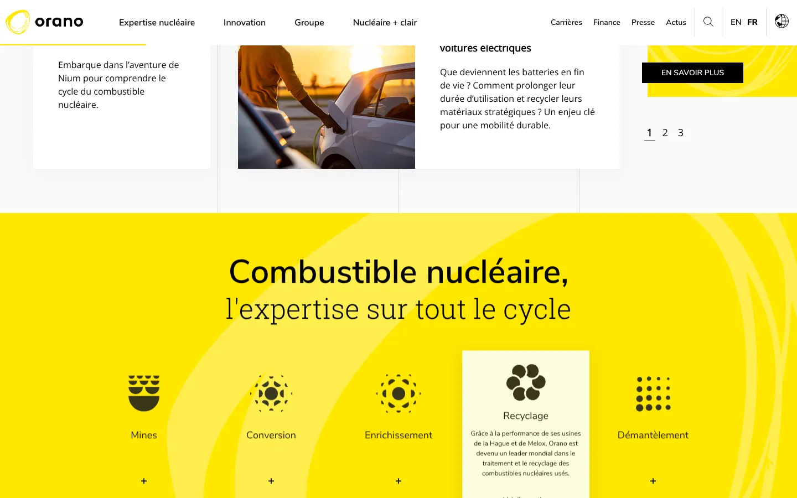

- **Do, layout.** Marker 06, title Automatizacija skladišta in the section size on columns 1 to 6, one offer line
  (marked dummy until Ekotehnika gives the real one), a spec row of what the robots do, the primary button.
- **Do, scene.** T is not a blank white field, the najam floor turns into a warehouse floor with drawn lanes. In AT
  the C-Matic 10 and C-Matic HP at true scale (no 3x), moving in a believable warehouse aisle with racks, their
  routes drawn as precise system lines (1px, dashed, small arrowheads, stop markers) in one info colour, a docking
  station and a pallet pick at the ends. Boxes on the robots as now.
- **Don't.** No giant single word, no toy scale robots, no dotted diagonals between pale circles.

## Part D, sections after the story

Builder 1. Normal page sections, no timeline change.

### D1. Statement

Filip, note 4, the marquee around a centred image.

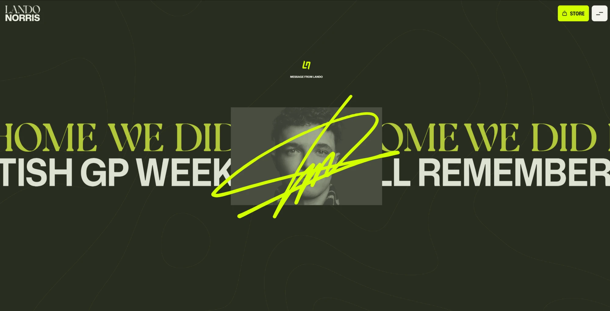

- **Do.** Two rows of Light 350 at 160px running edge to edge in opposite directions with scroll, row one Snaga koja
  pokreće (the tagline from the logo), row two Od 1997. širom Srbije i Crne Gore, black on white. A centred card
  480 by 320 with one delivery photo, the rows pass behind it. A small label above (Ekotehnika, Vrčin).
- **Don't.** No signature, no serif.

### D2. Proizvodi

Filip, S11 "Wordpress 2011 screen, really bad".

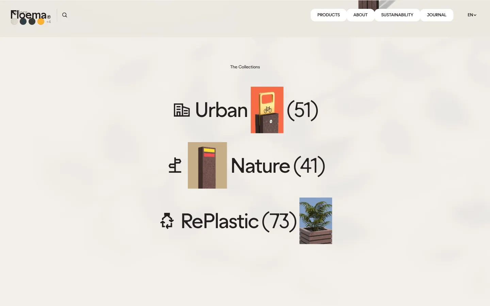

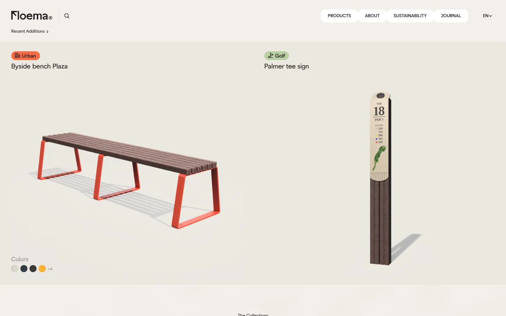

- **Do.** Section head, title Proizvodi on the left, two line lede top right (ref 03 head). Then a Floema style list,
  one line per type at 56px Regular (Čeoni viljuškari, Retrak viljuškari, Paletari i slagači, Komisioneri,
  Automatizacija), each with a small cut out image inline and the model count in brackets, hover lifts the image
  and opens the type page on ekotehnika.rs. Under it a staggered grid of four product cards (ref 03), one Linde cut
  out per card centred on a hairline outline, a notched tab bottom right with the model name in black and the type
  in `#6b6b6b`. Then the four delivery photos as a composed collage after ref 02, one tall and three smaller off grid.
- **Images.** Linde cut out renders from the Drive truck folder (Freisteller files and transparent PNGs per series),
  converted to webp with alpha in `public/products/`. Where a series has none, our GLB rendered on transparent in
  one light setup.
- **Don't.** No line icons, no row of equal grey cards, no plain photo strip.

### D3. Klijenti, the logo wall

Ekotehnika gave permission.

- **Do.** A grid of logo cells, six per row at 1440, hairlines and plus marks at the crossings, each logo in `#6b6b6b`
  monochrome at a 40px height box, full colour on hover. A small label above (Poverili su nam) and the claim 1.000+
  klijenata.
- **Input needed.** The client list and logo files from Ekotehnika. The Drive names only Vemax and Belt. The wall is
  built with those two plus empty cells marked dummy until the list arrives.

### D4. Closing band and footer

Filip, S12 "same for footer giga bad execution".

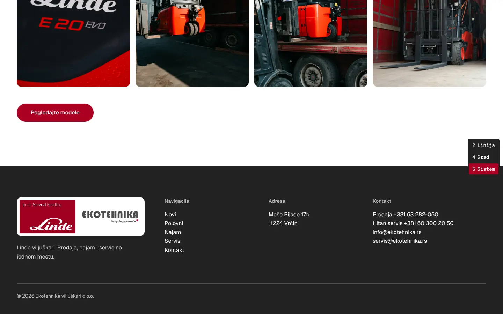
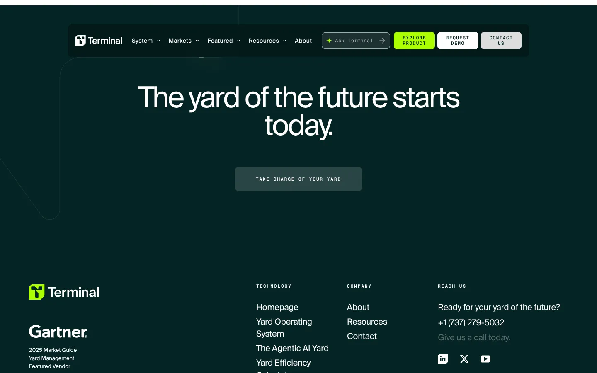
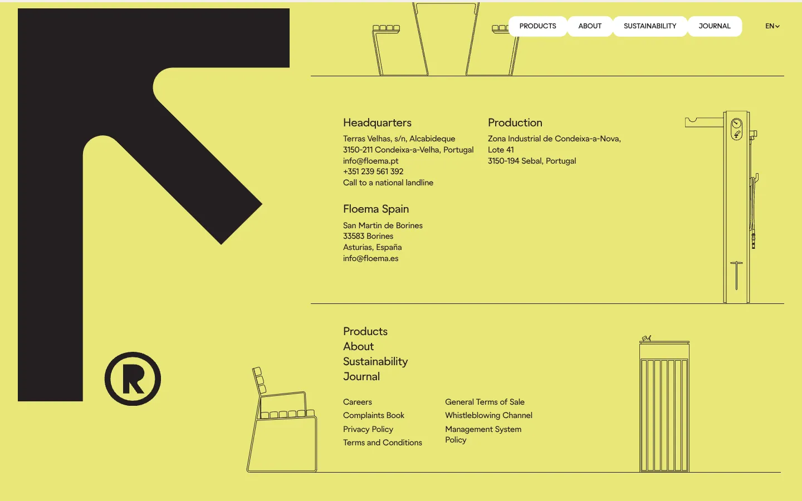

- **Do.** A closing band on white, one line at the section size (Recite nam šta vam treba, marked dummy) and the
  primary button, then the notched edge (B5) into the footer on `#e9e9e9`, not ink, so the red logo block is legal
  (p.12). Footer on the grid, logos unboxed at the A4 sizes top left, Hitan servis number at 40px Light as the
  loudest element, then Navigacija, Adresa, Kontakt columns with 15px links and the emails as mailto links, a ground
  line along the bottom with the drawn Linija trucks (MT15, H30, R16, N20) standing on it in black line art (F06),
  copyright and legal at the bottom.
- **Don't.** No ink footer with a boxed logo, no plain three column list as the whole footer.

## Part E, versions 2 and 4

Builder 3, after builder 1 lands. Files `src/story2/scenes/linija/*` and `src/story2/scenes/grad/*` only.

- **Do.** Check every hold beat of 2 and 4 under the new shell, keep the text areas plain where the new layout puts
  text (A3 columns, C1 columns 1 to 6, R columns 1 to 4, P columns 1 to 6, S columns 1 to 4, N top band, AT columns
  1 to 6), and the logo area plain at x 48 to 400, y 24 to 120.
- **Don't.** No redraws beyond what framing needs.

## Part F, check and ship

1. Before shots exist in `refs/current/` for version 5. Take the same set for 2 and 4 before builder 3 starts.
2. After shots of every beat at 1440 for 2, 4 and 5, side by side with the before set, every change traced to an
   item in this plan.
3. `/uireview` once on the finished pass, one round and one re check, then the decision card.
4. Contrast on real pixels behind every text, body 4.5 to 1, large titles 3 to 1.
5. tsc clean, no console errors, the version switch works, reduced motion works.
6. Filip checks scroll on a real GPU.
7. Deploy to production from a clean copy as today, then the link to Filip.

## Build order

1. Builder 1 (shell, type, colour, grid, top row, buttons, data rows, markers, motion, layouts in part C, sections in
   part D) and builder 2 (the Sistem scene, every scene item in part C) run in parallel, they touch no shared file.
2. I check both at full size, send fixes back once, then commit.
3. Builder 3 adjusts Linija and Grad framing.
4. Part F.

## Inputs still needed from Filip or Ekotehnika

- The client list and logo files for the wall (D3).
- FF Dax Pro files if headlines should use Dax Pro and not Daxline Pro (A1). The Drive has Daxline Pro only.
- The real automatizacija offer line (AT), until then marked dummy.

## Not in this pass

- The najam calculator (T06), needs real prices.
- A servisna mreža map (O02), a good later section once Ekotehnika gives the service locations.

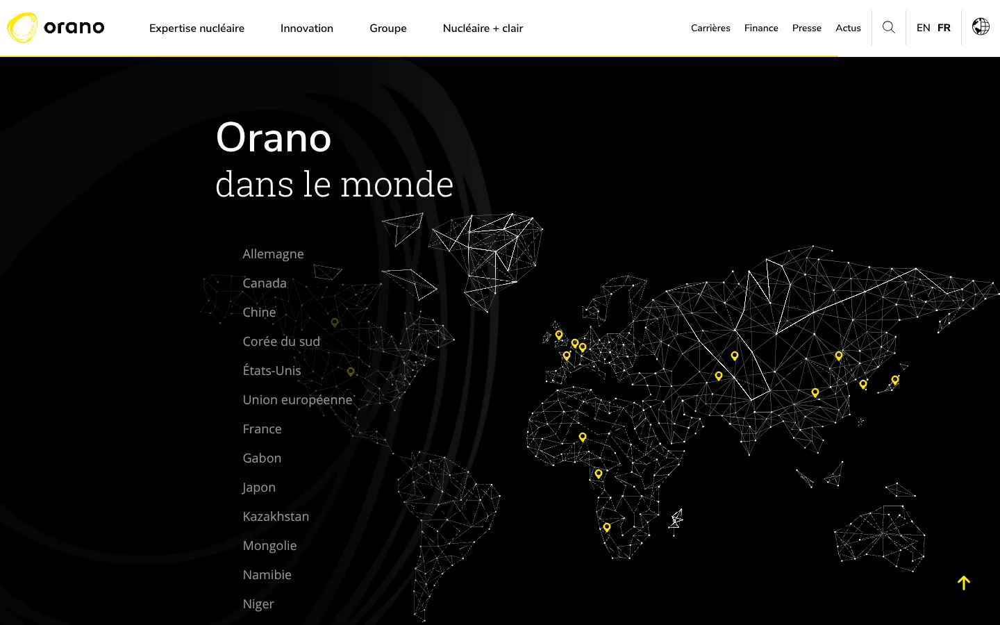

## Done

No open sev 1 on the `/uireview` card, every scene note S1 to S12 answered on screen and traced in the after shots,
the timeline unchanged, and the preview URL live.
