# Round 3, Filip's comments of 12 October afternoon

Every comment Filip left on the review board and in the chat after the 1920 ruling, one item each, with his words,
the screen as it is now, what is measured, the fix and the files. No code moves until Filip approves this plan.

- **Baseline** that must not regress is commit 4903513 on `claude/awesome-faraday-lkhnn2`.
- **The story timeline does not change.** 12,000px, the same 15 beats, spans and holds. Timing inside a beat may change.
- **Shots** are 1920 by 1080 for the board, per the 2026-10-12 ruling, and 1440 for `/uireview`, per the README Widths line.
- All images below are in `refs/round3/`, shot at 1920 from commit 4903513 unless named otherwise.

## Answers needed first

Filip replied "Build the plan execute everything" on 12 October, so every default below stands except Q2, which he answered himself.

- **Q1, button cell.** Your pin "lets use this variant" landed on the board as a whole. Item 1 changes how every secondary looks, so the board is reshot with that change, one frame per cell, and you pick from that. Default is 1A until you name a cell such as 3C.
- **Q2, logo on dark. Answered 12 October.** Filip, "Just keep Linde logo as is and convert ekotehnika logo to light (white)". So on dark the Linde logo shows unchanged and the Ekotehnika wordmark turns white. The options below are kept for the record. Default was option 3. The top band, 136px with the logos, nav and buttons, stays white over the dark beats, and the dark starts under the top rule. Option 1 keeps it hidden. Option 2 is a white field behind the logos, close to the rejected white frame. Option 3 changes how the dark servis beat looks, so before you pick, the board gets one mock frame of option 2 and option 3 on S in version 5.
- **Q3, illustrations in versions 2 and 4.** Default is yes to all four points. Carry every S note into both versions in their own style, AT first, and no red outlines on dark. Filling the empty left half of T in version 5 is my addition, not something you raised, so it is a separate yes.
- **Q4, grid lines behind text.** Default is the lines run unbroken across the whole stage, under the text layer, with no cut outs around text boxes. Text sits on top and stays readable because the lines drop to low opacity (item 2).
- **Q5, where the delivery photos go.** Default is N, Najam, see item 7. Its copy is "24 sata isporuka" and "Besplatna dostava i preuzimanje", which is what the photos show.
- **Q6, footer direction.** Default is the direction in item 9, in words, built only after a yes.
- **Q7, products section direction.** Default is the direction in item 8, in words, built only after a yes.
- **Q8, the old review.** `/uireview` is blocked by ekotehnika-1, a review of version 1 code from the first hero build. Default is you paste `drop ekotehnika-1`, then `/uireview` runs on this round.

## 1. Secondary buttons have no visible edge

Filip, on the hero and the top row "poor visibility contrast", and on the dark servis screen "again needs to be better executed".

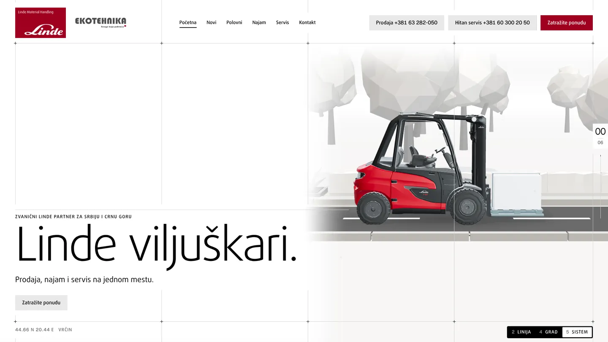
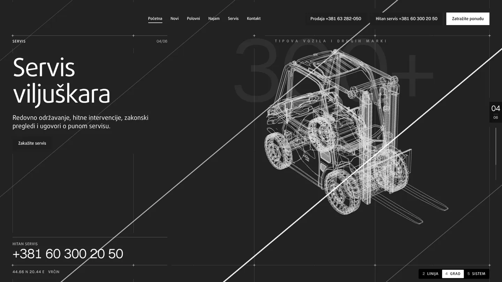

- **Measured.** On light the fill `#e9e9e9` sits on `#fcfcfa`, 1.18 to 1. On dark the fill `#1f1f1f` sits on `#1f1f1f`, 1.0 to 1, so the button has no shape at all. A control edge needs 3 to 1 (WCAG 1.4.11).
- **Fix.** Every secondary gets a 1px inset line at 50 percent, black on light and white on dark, over a 4 percent tint. Measured 3.96 to 1 on light and 5.1 to 1 on dark. Text stays black on light and white on dark. The patch is parked at `parked/secondary-line.patch`.
- **Files.** `src/ui/heroframe.css` only.
- **Check.** Shots of H, P, S, N and AT in 2, 4 and 5, and the button board, before and after.

## 2. The grid is broken and sits hard on the scene

Filip, "Grid is broken and also these needs to be done and set an opacity so it doesn't just go over the content. If it's going against darkmode it needs to be white opacity, if it goes under lightmode it needs to be dark opacity border, so it has nice visibility. 2nd screenshot could benefit from a mix of light/dark opacity border."

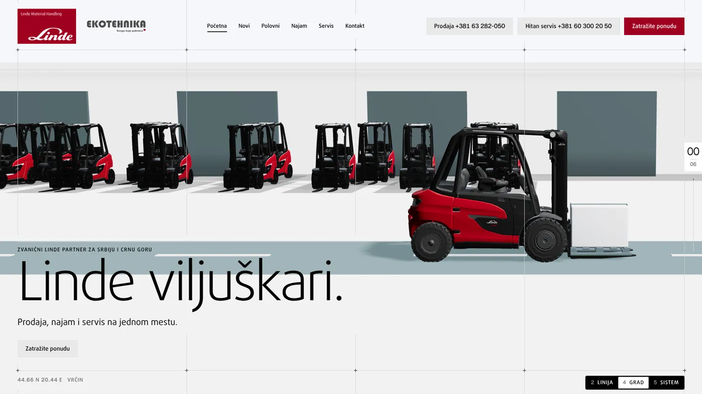

- **Cause, breaks.** `StoryShell.tsx` cuts the line layer out behind every `[data-mask]` text box (`maskStyle`, mask composite exclude). So a vertical stops wherever a title, lede, list or button block sits, at x 1016 under the hero headline block for example.
- **Cause, missing marks.** Plus marks exist only where the five verticals meet the top and bottom rules, 10 marks. A pane's own block rule, such as the hairline over the hero marker at y 703, gets no mark where a vertical crosses it.
- **Cause, contrast.** Lines are solid `#d2d2d2` on light, 1.47 to 1, and white at 18 percent on dark. Over the red truck the solid grey reads as a scratch on the model, and over dark scene parts it disappears.
- **Fix, lines.** Per Q4, no cut outs. Each line becomes a pair, 1px black beside 1px white, so the dark half reads on light ground, the white half reads on dark ground, and over the red and black truck both halves read, which is the mix Filip asked for.
- **Starting values, measured.** Black at 18 percent gives 1.52 to 1 on the white ground, a touch above today's solid grey at 1.47 to 1, so lines do not get weaker on white. Black at 12 percent would drop to 1.31 to 1 and is too faint. White at 40 percent gives 2.22 to 1 on Linde red and 3.79 to 1 on the `#1f1f1f` dark ground. These are a start, tuned on real pixels until a line reads on every ground without beating the content.
- **Fix, marks.** A plus mark at every crossing of a vertical with any horizontal rule on screen, the top and bottom rules and each block rule, from the same whole pixel numbers. Marks keep their solid ink.
- **Files.** `src/story2/shell/Grid.tsx`, `src/story2/shell/StoryShell.tsx` (mask), `src/story2/shell/shell.css`.
- **Check.** Shots of every hold beat in 2, 4 and 5, and one zoomed crop per ground (white, scene, dark) to check the pair.

## 3. Prodaja switches models too fast

Filip, "Animation and switching on this screen goes too fast could be better executed".

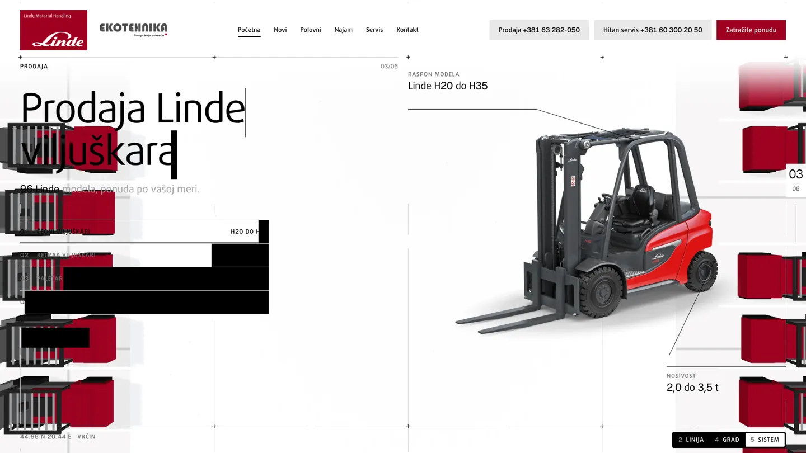
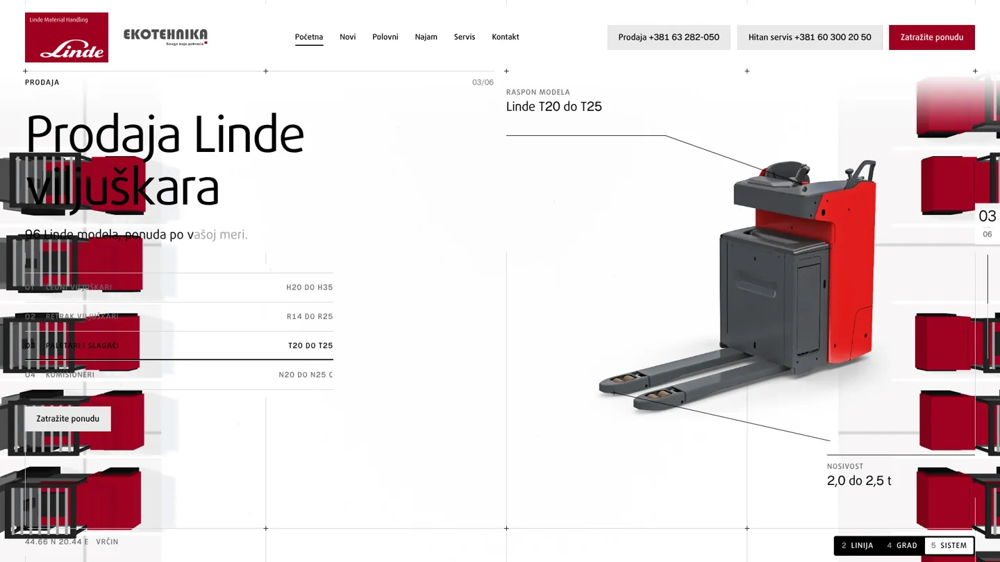
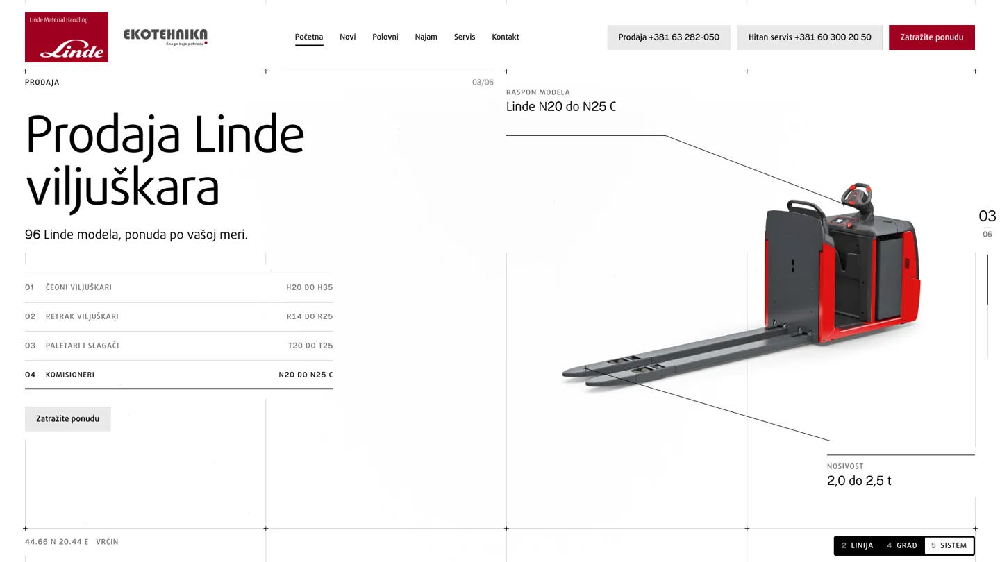

- **Measured.** The P hold is 1,100px of scroll. The shell steps the tab every 0.11 of the hold (`Math.floor((k - 0.05) / 0.11)`), so all four models flip by k 0.38, 121px each, about one wheel tick. The cut out swaps by a 520ms clip wipe with the leader lines and specs swapping at the same moment.
- **Also found.** Until about k 0.45 the red rack trucks from the transition still cross the left text column (first image), so the title, lede and tabs sit on top of 3D trucks.
- **Fix, pace.** One model per 0.22 of the hold, 242px each, at k 0.06, 0.28, 0.50 and 0.72, the last one held to the end. A clicked tab still stops the loop.
- **Fix, motion.** The outgoing cut out slides 48px left and fades over 400ms, the incoming one comes in from 48px right over 600ms with the same ease. The leader lines draw on after it lands, 120ms apart, then the range and capacity text rolls in. The active tab's bar fills over the same 600ms, so the list shows where in the four the story is.
- **Fix, overlap.** The scene clears columns 1 to 6 before P's text appears, by moving the rack trucks out earlier inside the transition beat. The beat's span stays the same.
- **Fix, clipped text.** "N20 do N25 C" is cut in the tab and the title. The tab range and title get the width they need.
- **Files.** `src/story2/shell/StoryShell.tsx` (step), `src/story2/shell/panes.tsx`, `src/story2/shell/shell.css`, and the Sistem scene timing for the overlap in `src/story2/scenes/sistem/`.
- **Check.** A frame strip of P at k 0, 0.1, 0.2 and so on to 1.0, and a short screen recording at real scroll speed.

## 4. Versions 2 and 4 illustrations

Filip, "The illustrations should have been edited to be better executed I told you".

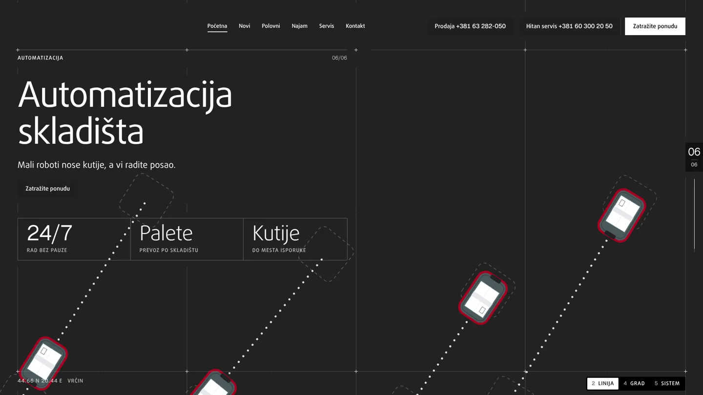
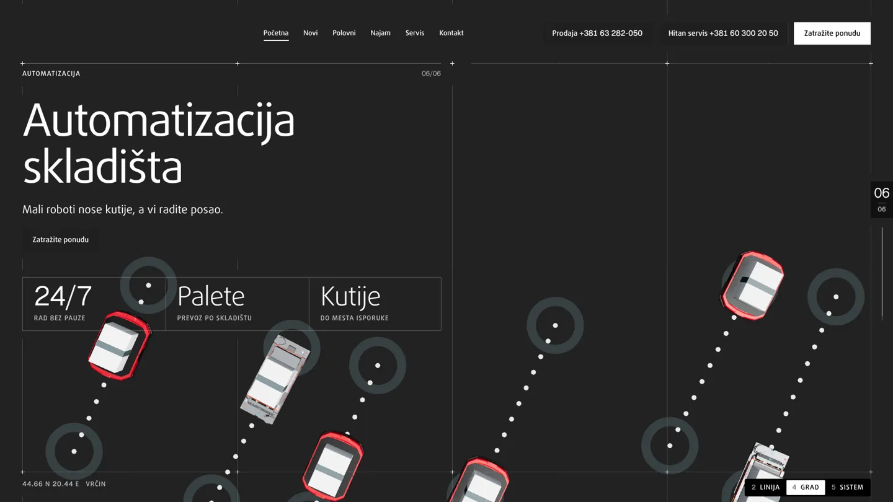
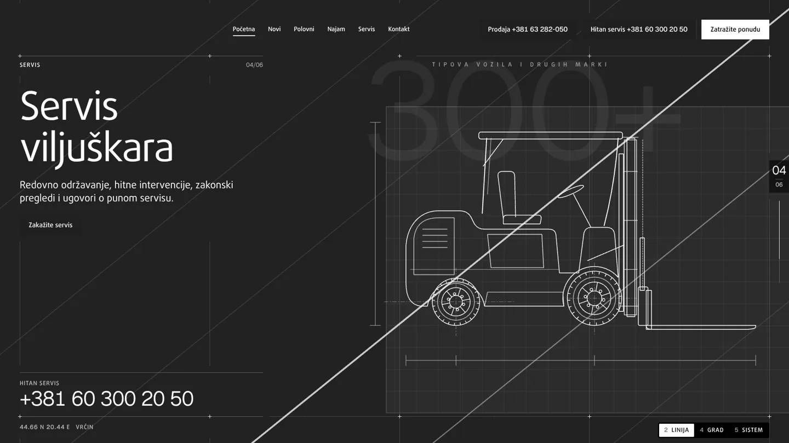

- **Why it happened.** Part E of the round 2 plan kept the scenes in 2 and 4 with "no redraws beyond what framing needs", because every S note was marked on version 5. That reading was too narrow. Builder 3 also stopped without fitting either version.
- **What is wrong now.** Both AT screens still carry the S10 treatment Filip rejected, top down robots on dotted diagonals between circle docks. Version 2 draws red outlines on the dark ground, against "no red on dark". The S screens keep their old drawings with diagonal speed lines that cut across the title column and the top row.
- **Fix, per Q3.** Every S note carried into each version in its own drawing language, line art on dark for Linija, the 3D city for Grad. AT first on both, then C1, R, P, S, N and T in story order. Red outlines on dark become white or grey. The speed lines on S stay inside the scene half and never cross text or the top row.
- **Files.** `src/story2/scenes/linija/*` and `src/story2/scenes/grad/*` only, one builder each, so no file has two owners.
- **Check.** Before and after strip of every hold beat in 2 and 4.

## 5. The top row button is the primary on every beat

Filip on V4 H, "Should be primary button" and "zatrazite ponudu here is not red and noone is red here".

- **Done** in 4509399 and logged as app wide. The top row Zatražite ponudu is red on light and white on dark on every beat. Beat buttons are secondaries.
- **Left.** None, it shows up on the board with the 1920 reshoot.

## 6. Sections after the story removed

Filip, "Remove these sections", "Remove these two sections", "Remove this section".

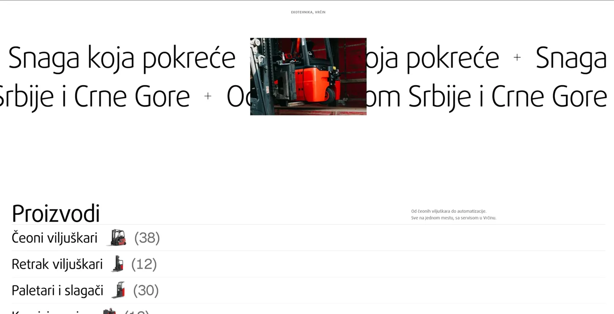

- **Done** in 73d1380. The statement marquee, Proizvodi, the client wall and the closing band are out, only the footer follows the story.
- **Changed since.** Filip then asked for a products section back, better executed. That is item 8. The taste log entry for the removal already has its carry forward rewritten in 3c3f64b, so it no longer bans a products section.

## 7. Delivery photos inside the story

Filip, on the removed collage, "These images should have been set like this somewhere during the storyboard and story telling, identify and find placement / spacing where to do this".

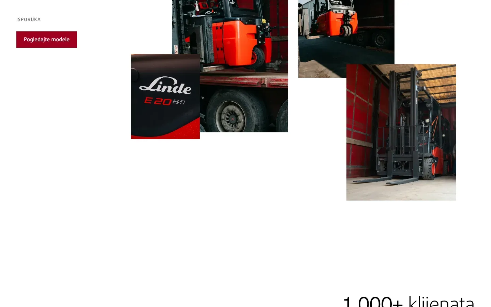
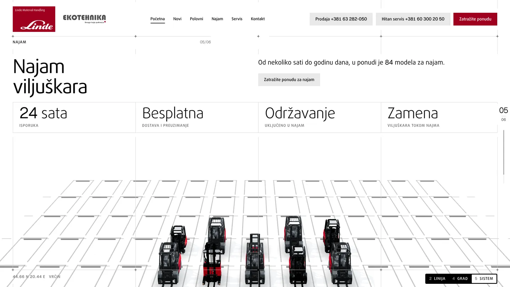
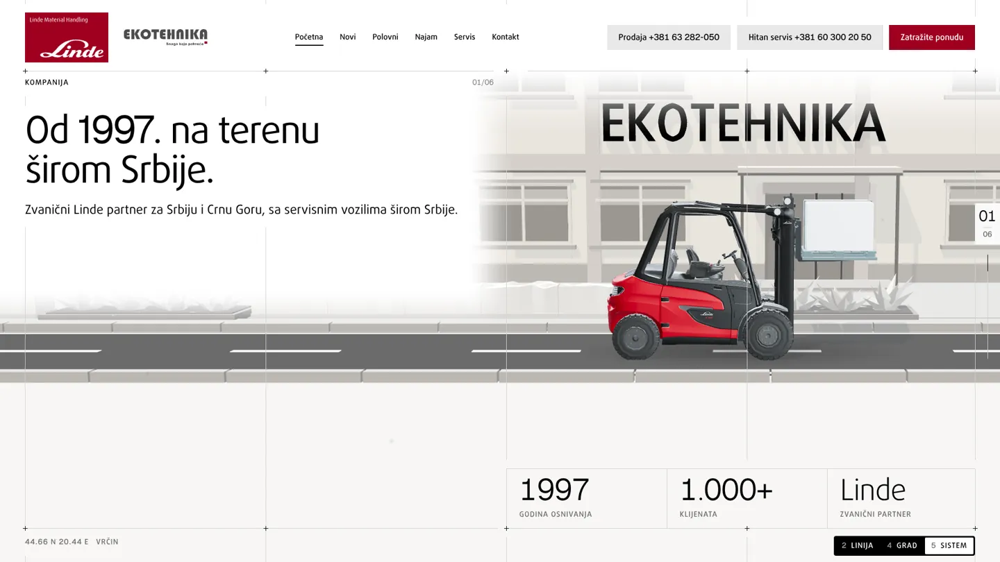

Three places were checked, with the one I would pick first.

- **N, Najam (pick).** The copy is "24 sata isporuka" and "Besplatna dostava i preuzimanje", the photos are trucks coming off a lorry. N's title, lede and stat row reach down to about y 500 at 1920 by 1080, so the collage takes columns 1 to 6 from y 528 to the bottom rule at 1015, about 900 by 487, and the rental floor scene frames into columns 7 to 12. Four photos overlap as in the removed collage, one large (about 430 by 390), one tall, one wide and the E20 EVO badge detail on top, each offset by whole grid steps of 24px, square corners. It costs a reframe of the N scene camera in versions 2, 4 and 5.
- **C1, Kompanija.** The empty band under the road, columns 1 to 6, y 736 to 1015, is only 280px tall, so the photos would shrink to about 280 by 190. It proves "na terenu širom Srbije" but reads as a thumbnail strip.
- **P, after the fourth model.** The cut out could give way to the collage for the last part of the hold, but that spends the scroll item 3 needs to slow the models down.
- **Files.** `src/story2/shell/panes.tsx` (NPane), `src/story2/shell/shell.css`, `public/photos/isporuka-1..4.webp`. The N camera in `scenes/linija` and `scenes/grad` is done by the item 4 builders inside their own folders, and in `scenes/sistem` by the shell builder, so no folder has two owners.
- **Motion.** The photos reveal one by one with the block wipe the titles use, 120ms apart, with a small parallax of up to 24px against the scroll.

## 8. A products section, better executed

Filip, on the round 1 Glavni proizvodi screen, "we do need a section like this but better executed UI wise".

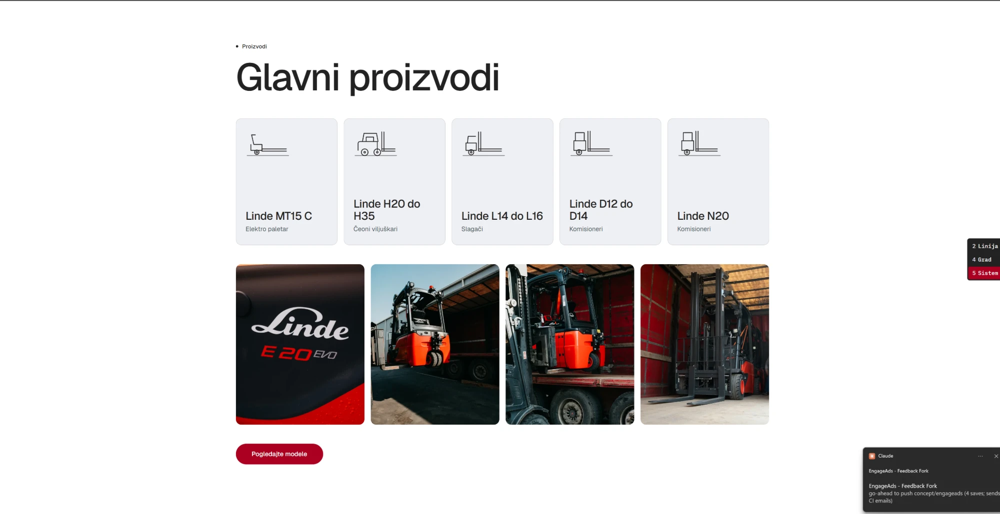

The kicker, the 96px title, five equal rounded cards with thin icons, a row of four rounded photos and one red pill button. It has no grid, no hierarchy and no motion, and its rounded corners now break the sharp corners ruling. Direction in words for Q7.

- **Layout.** One section right after the story, on the same 12 column grid with the hairlines and plus marks of the story, so it reads as the story's next cell. Columns 1 to 4 hold the label Proizvodi, the title "Glavni proizvodi", one lede line and the primary "Pogledajte modele" (the top row is gone here, so this is the view's one primary).
- **Products.** Columns 5 to 12 hold the categories as grid cells, not cards. Each cell shows the real Linde cut out from `public/products/` (H30D, E16P, R16, L14R, T20R, N20C, C-Matic 10), the name, the model range and the capacity in Geist digits, with the count of models at the cell's top right. Cells share hairlines, no gaps, no shadows, no rounding.
- **Motion.** The cells reveal in a stagger as the section enters. On hover the cut out moves up 8px and the cell gets the pale grey fill, the name underline draws on. No arrows.
- **Photos.** If Q5 puts the collage in N, this section carries no photos. If Filip wants them here instead, they sit as one row of four under the cells, edge to edge in the same cells.
- **Files.** `src/story2/shell/sections.tsx`, `src/story2/shell/shell.css`, `src/story2/copy.ts` for counts and ranges, which stay marked dummy until Ekotehnika confirms them.

## 9. A better footer

Filip, "Better executed footer".

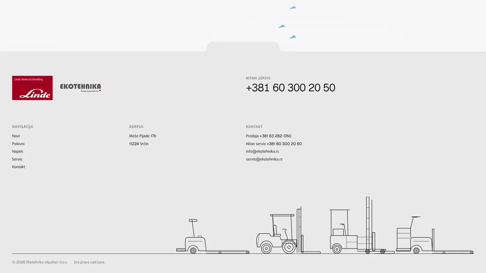

- **What is wrong.** Three columns of 15px links float in a pale band with a wide empty gap between them and the line art, the Hitan servis number stands alone at the top right, and the drawn trucks sit in a corner with no relation to the columns.
- **Direction in words for Q6.** The footer keeps the story's grid, the same verticals and plus marks, so it closes the page on the system. Row 1 holds the two phone numbers as the largest type on the footer, Prodaja and Hitan servis side by side at 48px in Geist digits with their labels, and the email under each. Row 2 holds the logos at the guideline sizes, the address and the nav in grid cells at 16px. Row 3 is the drawn truck line, MT15, H30, R16 and N20, standing on the bottom rule across the full width with the copyright under the rule. The pale grey ground stays, so the red Linde logo stays on a legal ground.
- **Files.** `src/story2/shell/sections.tsx` (Footer), `src/story2/shell/shell.css`, `src/story2/shell/lineart.tsx`.

## 10. The review board

- **Done.** The board width ruling is logged as app wide, 1920 by 1080.
- **Left.** The board still shows 1440 frames. After the fixes above it is reshot at 1920 from the new commit, with one frame per button variant (60 frames, titled like "3C light"), so a pin names a variant by itself.

## 11. Found by me, not raised by Filip

- After the first scroll past the story, `document.querySelector('[data-after-story]')` matches the page root, which the shell marks with the same attribute, so the version switch stays hidden from then on. The fix is to query inside the body. `StoryShell.tsx`, `HeroFrame.tsx`.
- The story's last frame shows a strip of the AT scene above the footer notch, with blue route arrows cut by the band (image 11).

## Order of work

1. Filip answers Q1 to Q8.
2. Items 1, 2 and 11 together in the shell, one builder, since they share `heroframe.css`, `shell.css` and `StoryShell.tsx`. Then shots.
3. Item 3 and the P overlap, the same builder after step 2, since it touches `StoryShell.tsx` again.
4. Item 4, two builders in parallel, one in `scenes/linija`, one in `scenes/grad`. Each also reframes its own N camera for item 7, so it starts after Q5 is answered.
5. Items 7, 8 and 9 after their directions are approved and after step 3 has left `panes.tsx`, one builder for `sections.tsx` and one for NPane and the Sistem N camera.
6. Self check, before and after shots of every changed route at 1440 and 1920, contrast on real pixels.
7. `/uireview` once, one round and one re-check, then the card.
8. Board reshot at 1920, then the deploy with the git free copy, then the link.

## Done means

No open sev 1 on the `/uireview` card, every item above marked done with a before and after shot, the board at 1920 and
the preview URL live.
