# Round 4, Filip's video review of 12 October evening

Every comment from the 10 minute video, one item each, with his words, the time in the video, the frame, the cause
where it is known, the fix and the files. No code moves until Filip approves this plan.

- **Baseline** that must not regress is commit 6eeac77 on `claude/awesome-faraday-lkhnn2`, the current head.
- **The video** was recorded on localhost at `?v=5`, so every frame below is version 5. Times read 5m54 for 5 minutes 54 seconds.
- **The story timeline does not change.** 12,000px, the same 15 beats, spans and holds. Timing inside a beat may change.
- **Version scope.** Items in the shell (buttons, grid, tabs, text, sections) reach 2, 4 and 5 at once, since all three share it. Items in the scene are version 5 only unless Q8 says otherwise.
- All frames are in `refs/round4/`, cut from the video.

## Read this first

- **Two defects are in the deploy 1 preview.** The P cut out stays on screen for the rest of the page (item 14) and the top row blinks at the dark exit (item 17). That preview should not get a ship line. The next preview replaces it.
- **The render items are most of the work.** Items 3, 7, 15 and 20 rebuild scene models to the level of the rack boxes (item 25). Each is a model rebuild, not a tweak.
- **More detail and faster load pull against each other.** You raised both. I measure the download size and the time to first frame before and after, and any render item that makes either worse comes back to you before it lands.
- **The cloud container renders WebGL in software.** I can check layout and motion in shots, not real frame rate. The smoothness items (7 and 16) need you to judge them on the preview.

## Answers needed first

Filip replied "for the 3d work you can split into offbranches so we gain more speed, for the rest go" on 12 October, so every default below stands. Q10 and Q11 came later and Filip handed both to Claude, "resolve the open q10/q11 yourself".

- **Q1, R left edge.** You said a fade to white won't work, then that it may be fine. Default is no fade. The R scene is reframed so the yard runs to the column 4 grid line at 642 and stops there on a clean edge, and the text column sits on plain ground beside it. Option 2 is a white fade over columns 3 and 4.
- **Q2, hero load.** Default is no preloader screen. The page shows the white ground, the grid and the top row at once, then the grid draws on, the road and trees build in, and the forklift drives into place once its model is ready. A preloader adds a screen to wait on. Option 2 is a short preloader with both logos and a progress rule.
- **Q3, top nav.** You said "we can do better". Default is one direction in words, approved before code. The nav follows the story. The active link moves to the chapter on screen (Prodaja on P, Servis on S, Najam on N), a 2px rule slides under it, and hover draws the same border as the buttons. Today Početna stays underlined from the hero to the footer (frame 22).
- **Q4, L fork move.** Default is to finish the move. The fork rises through the whole frame, lifts the N grid into place, then drops out of frame, so the move has an end. Option 2 replaces it with a different move, which I would bring as words first.
- **Q5, S forklift.** You asked for "a proper 3D render of the Linde forklift". Default is the real X50 model on the dark ground, lit, with clean outline edges and the dimension lines kept inside the grid cells. The hand drawn line schematic goes. This reverses the 11.50am blueprint carry forward, so it needs your yes.
- **Q6, render budget.** Default is that the scene's total download stays at or under today's size plus 20 percent, and the first frame lands no later than today.
  - **Measured on 6eeac77**, `?v=5` at 1920, production build, software GL in the cloud container. 10.93MB on load, 11.69MB after a full scroll. First frame of the hero road at 18.4s and 19.0s in two runs, in software GL with two builders on the same machine, so the time only counts as a before and after on one container, three runs each, the median. A first reading of 977ms was wrong, the scene canvas reads back blank, so it timed the canvas appearing and not the scene drawing. The biggest files are the studio HDRI at 1.68MB, then d12 at 1.57MB, x50 at 1.56MB and h30d at 1.26MB.
  - **Budget per branch.** Street 1.0MB, automation 0.5MB, lift 0.2MB, servis 0.4MB, about 19 percent in all. First frame no later than before, measured back to back on the same container. The scripts are `ekotehnika-hero/scripts/loadbudget.mjs` and `ekotehnika-hero/scripts/scrollpass.mjs`, the real scroll check from item 14.
- **Q7, Grad session.** The Grad builder is blocked on two findings. F1 says the yard trucks use `#a00020` and not `#aa0020`. That is already settled by your 7.45pm guideline red ruling, so it is closed. F2 says the info turquoise on the S dimension lines is not a README token. Default is to keep it, since the plan set it. Then the builder fixes F5 to F9 and I merge its branch.
- **Q8, versions 2 and 4.** Default is that the shell fixes reach them, and the scene fixes stay in version 5. Grad scene work runs in its own session.
- **Q10, S after the footer ruling. Settled by Claude**, on Filip's "resolve the open q10/q11 yourself". The footer ruling does not reach S. What Filip rejected at 10.30pm was product stills on a grey ground in a row, a catalogue strip. At S he asked for "a proper 3D render of the Linde forklift", and the hero forklift, the real model lit in the scene, is the one he holds up as the polish bar. So S gets the real X50 lit in the scene on the dark ground, finished like the hero truck, with one clean outline on its silhouette and the dimension lines inside the grid cells. Logged in taste.md at 22:09. The servis branch starts on this.
- **Q11, footer scenery. Settled by Claude**, on the same line. The footer row becomes one wide still of the Ekotehnika site in Vrčin from the hero's own world, the company building with its name, the gate, trees, kerbs and one forklift parked by the door, seen low and side on like the hero, standing on the footer's bottom rule across all twelve columns, on the footer ground. It closes the page where the story began, beside the address cell. It refuses product shots, a row of trucks, line art and a live second canvas. The street branch renders it once from the reworked street set after item 7, as `public/footer/site.webp`, and this session wires it into the footer. Filip sees it on the preview with the rest.
- **Q9, box branding.** Default is the EKOTEHNIKA wordmark from the logo file on two faces of the pallet box in the hero, dark on the light box, in version 5. Not redrawn, per the README logo rule.

## Defects first

### 14. The P cut out stays on screen after P, through every beat to the page end

Filip at 5m37 and 6m45, "this shouldn't transition into this, and why it's transitioning with us", "this issue is carrying over".

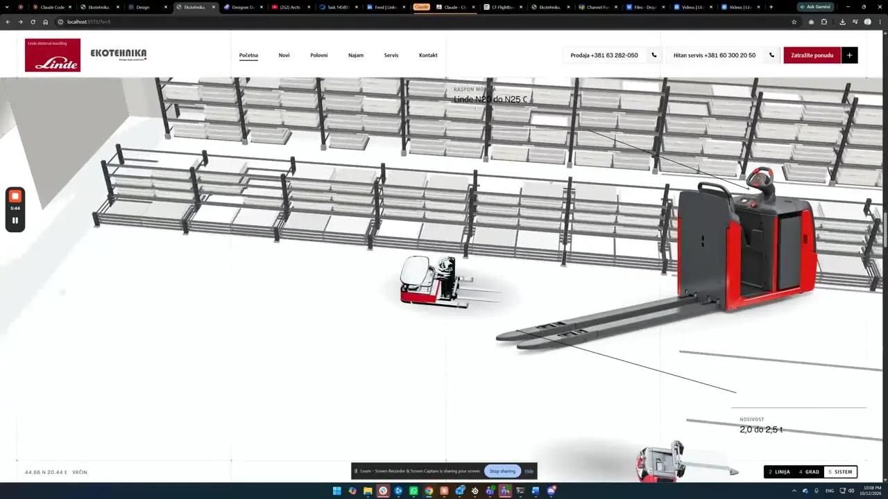
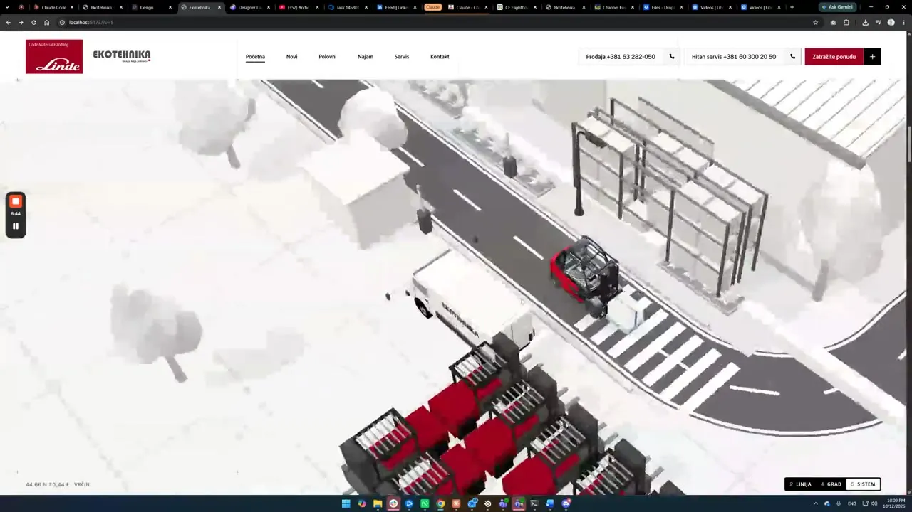

- **Cause, confirmed in code.** Two faults stack. In `StoryShell.tsx` line 202 the reset `setTab(G.tabs, -1)` hangs off `else` of `if (G.wrap)`, and P always has a wrap, so the last model is never put back when P leaves. Then `.p-fig[data-st='on']` in `shell.css` sets `visibility: visible`, which beats the hidden pane around it, so the cut out, its label, its leader lines and its capacity stay on screen over A, B, S, L, N, T, AT and Proizvodi.
- **Why the shots missed it.** Frozen beat shots load each beat fresh, so the last tab is never on. Only a real scroll shows it.
- **Fix.** Run the reset whenever P leaves, wrap or not, and set the on state to `visibility: inherit`, so the pane's own state always wins. Both, so a picked tab cannot leak either.
- **Files.** `src/story2/shell/StoryShell.tsx`, `src/story2/shell/shell.css`.
- **Check.** A new shot script that scrolls from H to the page end in real wheel steps and saves a frame per beat, in 2, 4 and 5. It joins the kit checks for every later round.

### 17. The top row blinks at the dark exit after L

Filip at 7m20, "it scrolls through and blinks. Everything just blinks for a second."

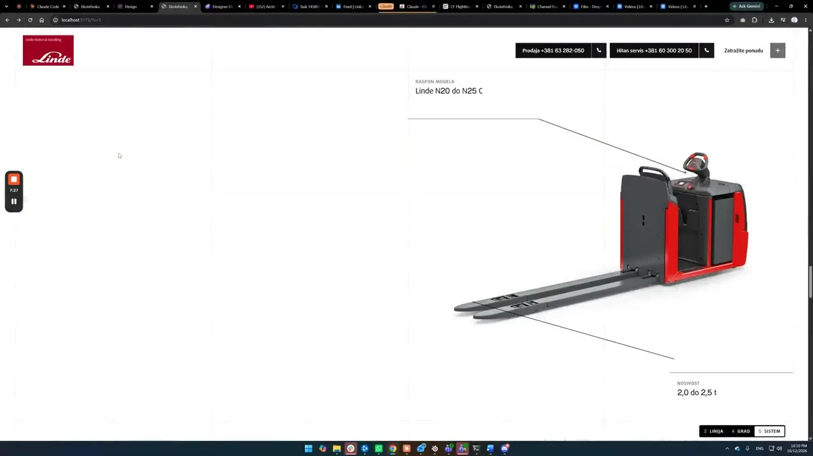

- **Measured.** In the frame the ground is already white but the top row is still in its dark state, black phone chips, a grey plus cell, and the white Ekotehnika wordmark gone on white.
- **Cause, likely.** The shell flips the top row by its own story pixel span, dark from 7790 to 9525 (`DARK_TOP` in `StoryShell.tsx`). The scene flips its own ground on a different number (`DARK_TOP_FROM` 9.475 in `sistem/overlay.tsx`, and the camera's ground in `camera.tsx`). For a few frames the two disagree. The stale P cut out (item 14) adds to the flash.
- **Fix.** One source for the switch. The scene reports when its ground is dark and the shell reads that, so the top row, the grid and the ground change on the same frame.
- **Files.** `src/story2/shell/StoryShell.tsx`, `src/story2/scenes/sistem/overlay.tsx`, `camera.tsx`.
- **Check.** The real scroll script from item 14, 20px steps from 9300 to 9800, every frame checked for a top row tone that does not match the ground under it.

## Hero

### 1. The marker rule is cut off

Filip at 0m40, "this line is being cut off here".

- **Measured.** The hairline over the hero marker runs from the left grid line and stops at about 735 of 1280 in the video, inside column 3, on no grid line.
- **Fix.** The rule ends on a grid line, the column 4 line, with a plus mark at the crossing like every other block rule.
- **Files.** `src/ui/heroframe.css` or `src/story2/shell/shell.css`, whichever draws it.

### 2. The hero loads in like an image

Filip at 0m50, "anything that just loads in is an image, which I don't like. Either we need to do a preloader on the website or something else needs to happen".

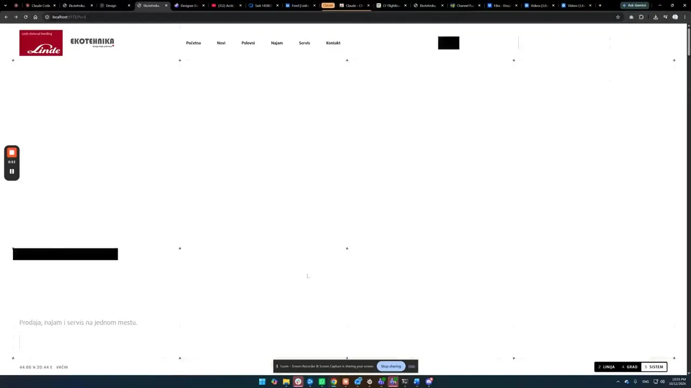

- **Fix.** Per Q2.
- **Files.** `src/story2/shell/StoryShell.tsx`, the hero entrance in `src/story2/scenes/sistem/`.

### 3. The trees look like they float

Filip at 1m17, "it feels like they're floating on there or something... this doesn't look executed good."

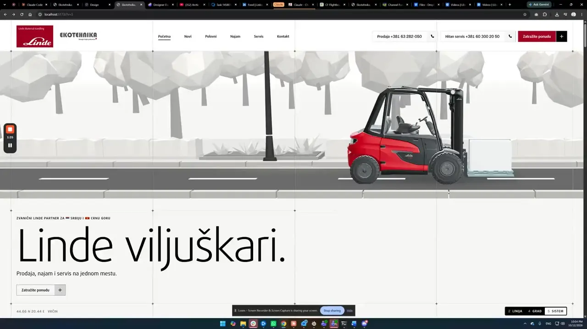

- **Cause, likely.** The trunks meet the ground with no contact shadow and no planter or verge, and the crowns are one flat grey, so they sit on the white like cut outs.
- **Fix.** Contact shadows under each tree, trunks set into a kerb strip and verge, two tones on the crowns from the light. Same count of trees, inside the Q6 budget.
- **Files.** `src/story2/scenes/sistem/`, the street set.

### 4. Ekotehnika on the box

Filip at 1m36, "maybe we can do like Ekotehnika on the box here. That would be a kind of dope idea."

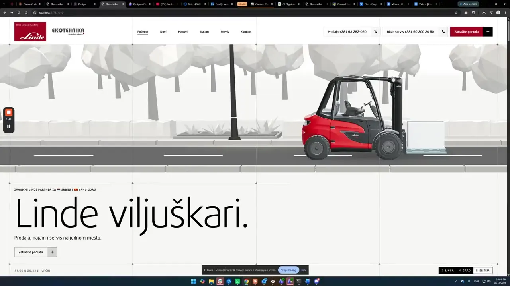

- **Fix.** Per Q9.
- **Files.** The box material in `src/story2/scenes/sistem/`, the logo from `public/brand`.

### 5. Secondary buttons too strong

Filip at 1m45 on the hero, and again at 4m45 on Z, "the opacity is too strong for this button and I think it needs to be like here".

- **Measured.** The top row phones are at quarter weight, edge 12.5 percent. Every other secondary is at the 50 percent edge from round 3.
- **Fix.** Every secondary on every beat moves to the top row's quarter weight, so one secondary look holds site wide. Black on light, white on dark, same numbers.
- **Note.** A 12.5 percent edge measures 1.37 to 1, under the 3 to 1 that WCAG 1.4.11 asks of a control edge. The label and the icon cell still say it is a button, and you set this weight at 7.20pm, so I follow it and flag it here once.
- **Files.** `src/ui/heroframe.css` only.

### 6. A stray edge on the right of Hitan servis

Filip at 1m57, "there's a border here on the right where it says Hitan servis... fix it".

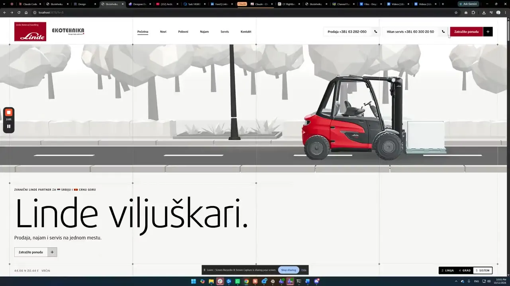

- **Measured.** A darker vertical line sits on the right edge of the Hitan servis button. The Prodaja button has none.
- **Cause.** Not known yet. Likely a leftover side of the border draw hover, or the gap between the phone cell and the primary. Measured on the build before fixing.
- **Files.** `src/ui/heroframe.css`.

## D1, D2 and F

### 7. The scroll out of the hero and the background modules

Filip at 2m10 to 3m45, "the transition to scroll kind of has to happen more smoothly", "these modules here in the background, they don't look as polished as this forklift does", "a bit too rustic and too playful, like the wheel".

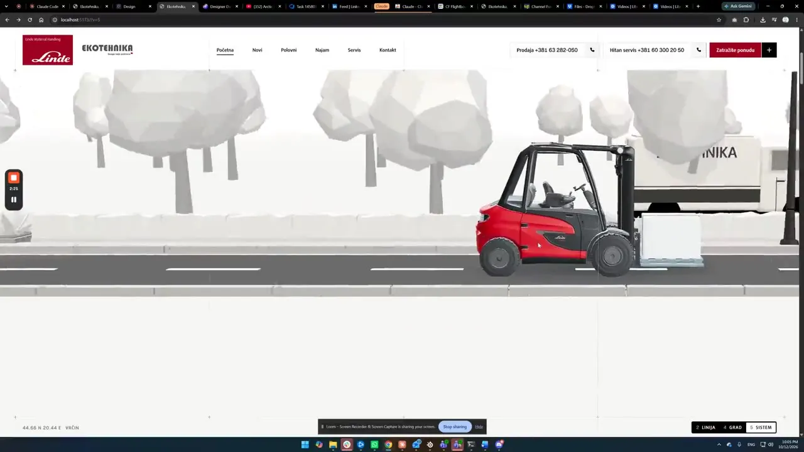
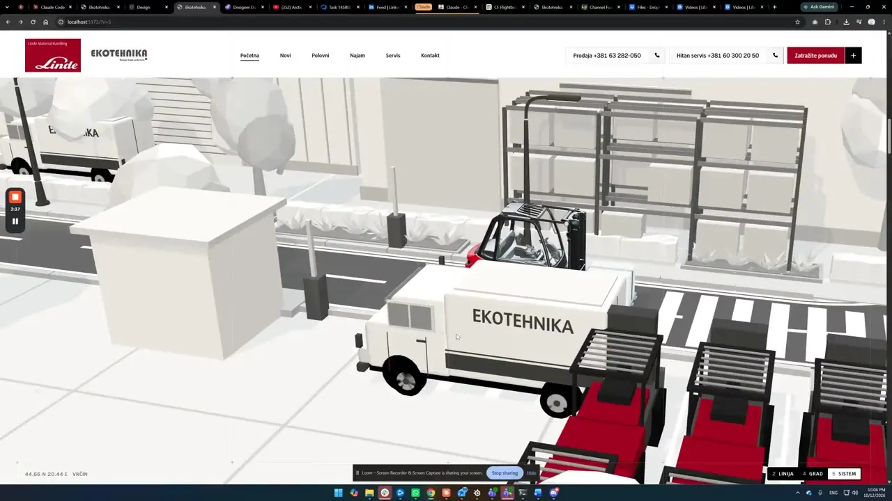

- **Fix, modules.** The vans, buildings, booth and trees rebuilt to the rack boxes' level (item 25). Real parts, panel lines, wheels with tyres, rims and hubs, signage blocks without text, contact shadows. Inside the Q6 budget.
- **Fix, scroll.** Measure the camera's speed curve leaving H. Where the speed jumps at a span edge, ease it across the edge. The timeline does not change.
- **Files.** `src/story2/scenes/sistem/`, the street and camera files.
- **Check.** You judge the feel on the preview, per Read this first.

## C1

### 8. Text over the scene is hard to read, and the move is too fast

Filip at 2m55, "visibility and readability on this part is bad, maybe then we can move this part of the UI to down here", "this animation is happening too fast".

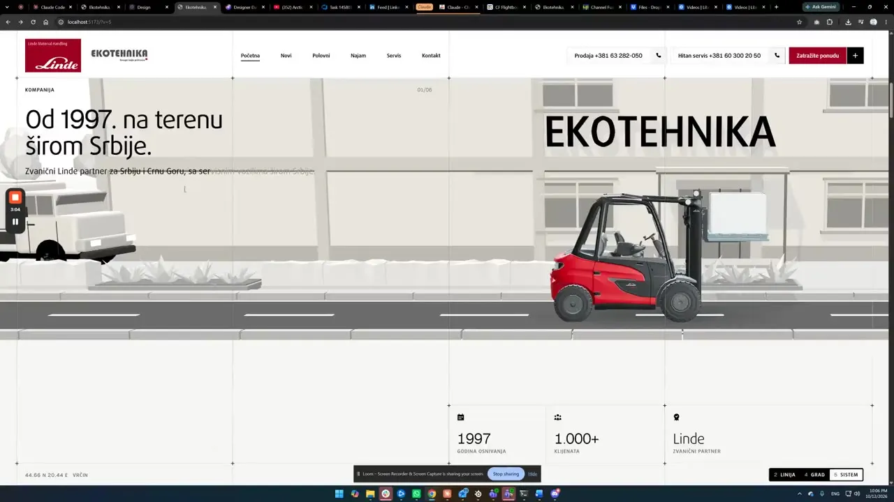

- **Fix.** The C1 text block moves down into the empty band under the road, on the grid. The building move inside C1 runs over more of the hold so it reads slower. The beat keeps its span.
- **Files.** `src/story2/shell/panes.tsx` (C1Pane), `shell.css`, the C1 camera in `src/story2/scenes/sistem/`.

## R

### 9. The yard is cut off at the left, and the list needs work

Filip at 3m45, "the scenery here is cut off... fading to white won't work. Maybe we can actually fade to white here and that's fine", "move it down, add icons, space it up a bit. The UI execution on here needs to be way better."

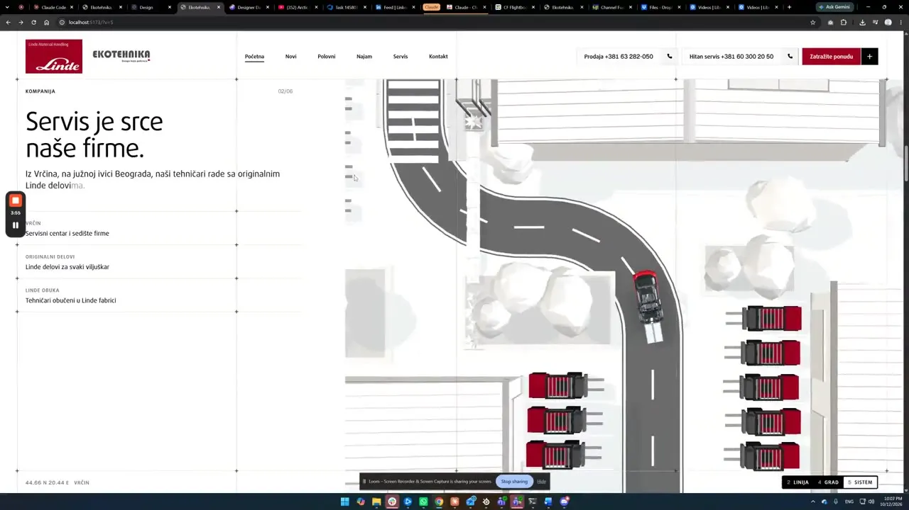
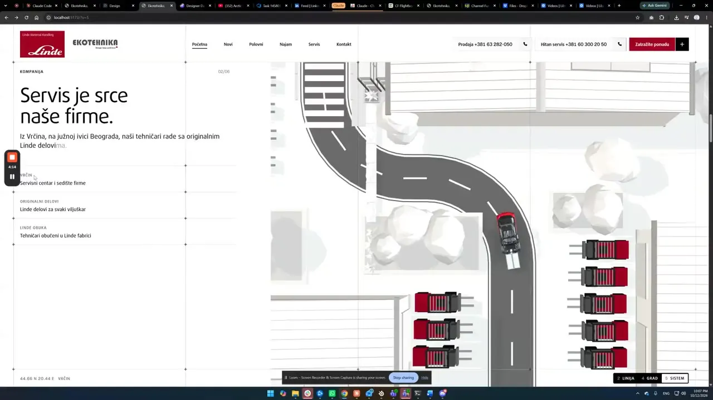

- **Measured.** The yard stops on a hard vertical at about 486 of 1280 in the video, between the column 2 line at 333 and the column 4 line at 642, so the cut sits on no grid line.
- **Fix, edge.** Per Q1.
- **Fix, list.** Vrčin, Originalni delovi and Linde obuka move down to the bottom of the column, get the 20px solid icons with the 32px gap used on N, C1 and AT, and get more space between rows.
- **Files.** `src/story2/shell/panes.tsx` (RPane), `shell.css`, the R framing in `src/story2/scenes/sistem/`.

## Z

### 10. Better, same button note

Filip at 4m45, "this is better executed, same comment for the button".

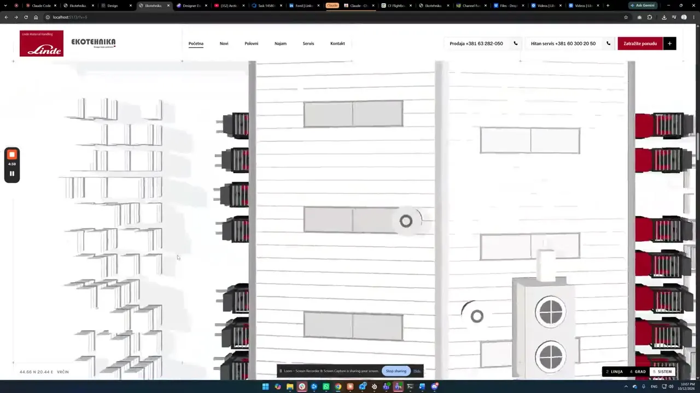

- **Fix.** Item 5 covers it. Nothing else changes on Z.

## P

### 11. The tab list, better and lower

Filip at 4m55, "we can better execute this area here, and we can maybe place it down below more".

- **Fix.** The tab list moves to the bottom of the left column, on the grid, with the button under it. Each tab row gets more height and the active row a clearer state, a 2px ink rule and the full ink label, the rest at text-grey.
- **Files.** `src/story2/shell/panes.tsx` (PPane), `shell.css`.

### 12. The leader lines point at nothing

Filip at 5m10, "I'm not happy how these are pointing, like Nosivost... They're not actually pointing to anything here, and this part of the UI is really bad", "we need to have more details to it".

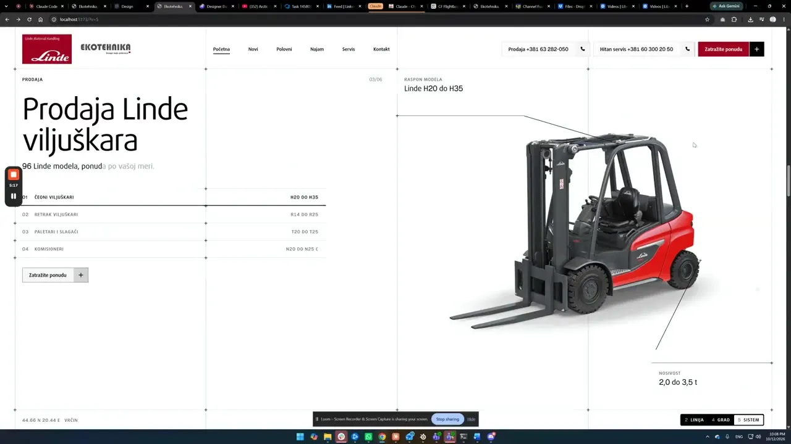

- **Cause, confirmed in code.** The dots are placed in percent of the stage box, while the image is fit inside it at 78 by 66 percent with `object-fit: contain`. When a model's image has a different shape, its parts move and the dots stay put.
- **Fix.** Each model gets anchor points in its own image pixels, a point on the mast badge for the range and a point on the fork tines for the capacity, mapped to the screen through the image's real fitted box. Each dot gets a small ring so it reads as a marked part.
- **More detail.** A third callout per model, only with facts already in `copy.ts` or on the live site, since the README allows no new numbers. If no third fact exists, the detail comes from the drawing, a dimension line along the forks.
- **Files.** `src/story2/shell/panes.tsx`, `shell.css`, `src/story2/copy.ts`.

### 13. Grid lines break in places

Filip at 5m20, "the line is disconnected. Here, the line is disconnected as well."

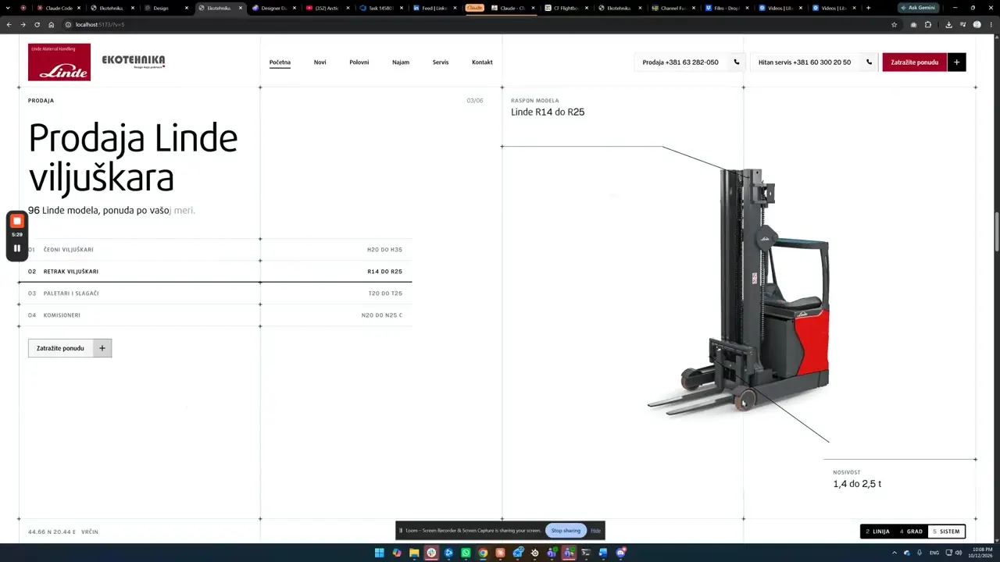

- **Cause.** Not confirmed. Likely the tab list's block rules stop short of the column lines, at 527 of 1280 in the video, on no grid line, and the plus marks miss them.
- **Fix.** Every block rule starts and ends on a column line, with a plus mark at each crossing. Checked on every hold beat, not only P.
- **Files.** `src/story2/shell/shell.css`, `Grid.tsx`.

## S

### 15. The schematic crosses the grid, flat wheels, a cut line

Filip at 6m00, "you see how this is going over the grid, the schematic needs to be outlined, the wheel is not 3D here. We need a proper 3D render of the Linde forklift here. And then this line is being cut off here."

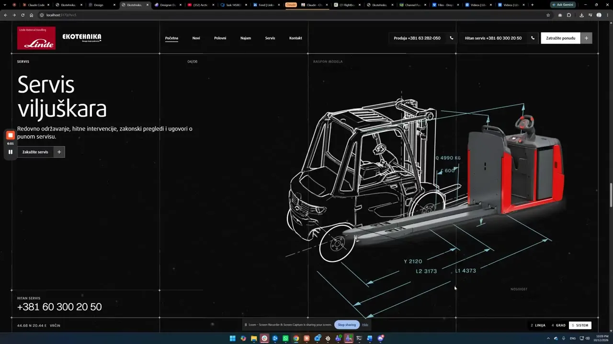
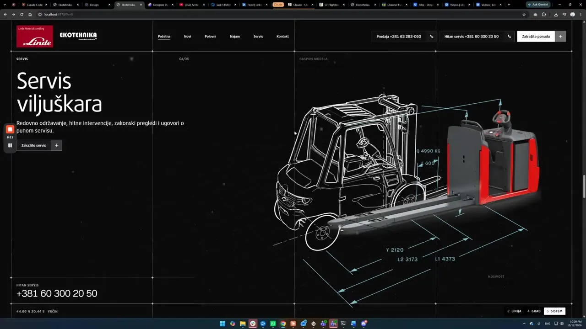

- **Fix.** Per Q5. Dimension lines end on grid lines or inside one cell, never across a line. No line is cut by the stage edge.
- **Files.** `src/story2/scenes/sistem/schematic.tsx`, `blueprint.tsx`, `src/story2/shell/panes.tsx` (SPane).

## L

### 16. The fork move is not finished

Filip at 6m54, "we can maybe do a cooler transition than this part here... either this goes till the end or something else. This is a good detail, but it feels unpolished and not executed fully."

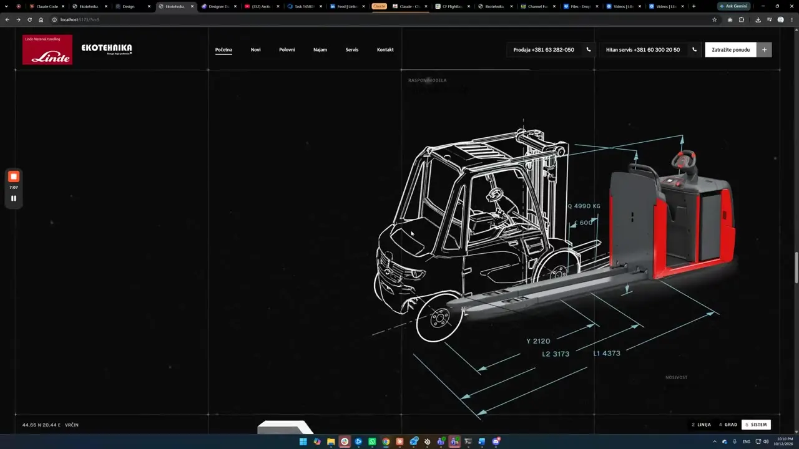

- **Fix.** Per Q4.
- **Files.** The L move in `src/story2/scenes/sistem/`.

## Nav

### 19. The top nav can do better

Filip at 7m52, "not the fan of this navigation here as much. This navigation is cool, but I think we can do better".

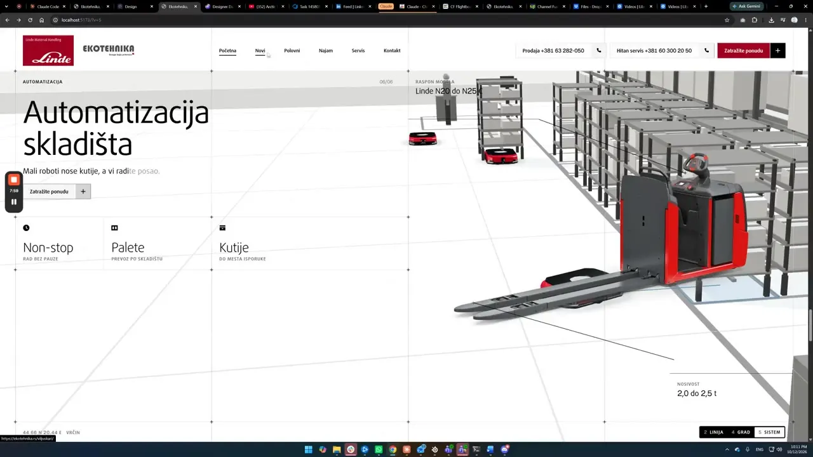

- **Measured.** Početna stays underlined from H to the footer, so the nav never says where you are in the story.
- **Fix.** Per Q3, words first, built after your yes.
- **Files.** `src/ui/heroframe.css`, the top row markup.

## AT

### 18. The facts row is uneven and hard to read

Filip at 7m36, "again a bit more poor readability. These boxes here are not equal. We can maybe place them down below more."

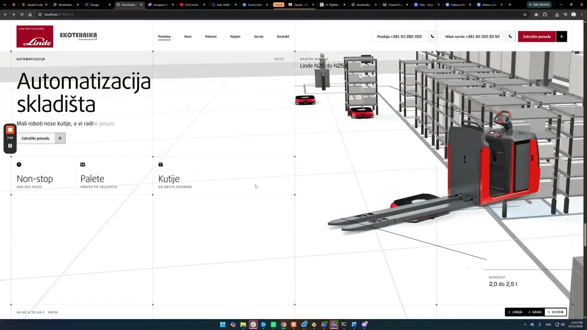

- **Measured.** Non-stop and Palete share columns 1 and 2, starting at 36 and 175 of 1280 in the video, while Kutije starts on the column 3 line at 345. So two narrow boxes sit beside one wide one.
- **Fix.** Three equal boxes, each on its own column line, moved down to the bottom of the left column. With item 14 fixed, the N20 cut out no longer sits over this text, which is half of the readability problem.
- **Files.** `src/story2/shell/panes.tsx` (ATPane), `shell.css`.

### 20. The shelves and the picker's arm

Filip at 8m14, "the animation here is fine. The shelves can have a bit more polishing. You see how his arm kind of goes away. That's an issue."

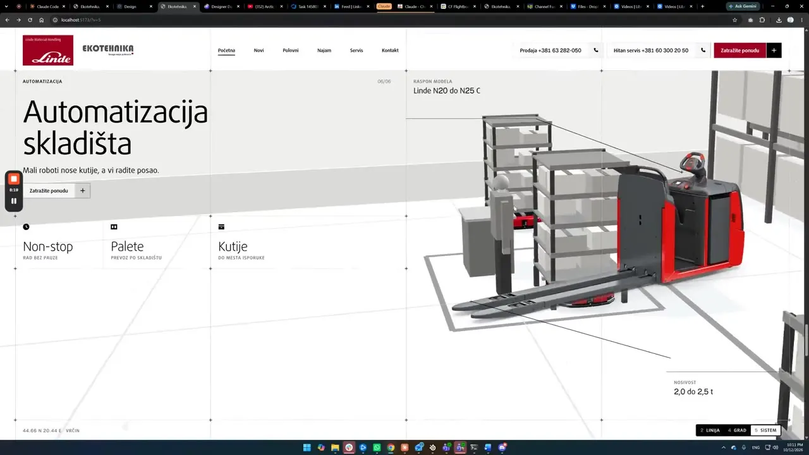
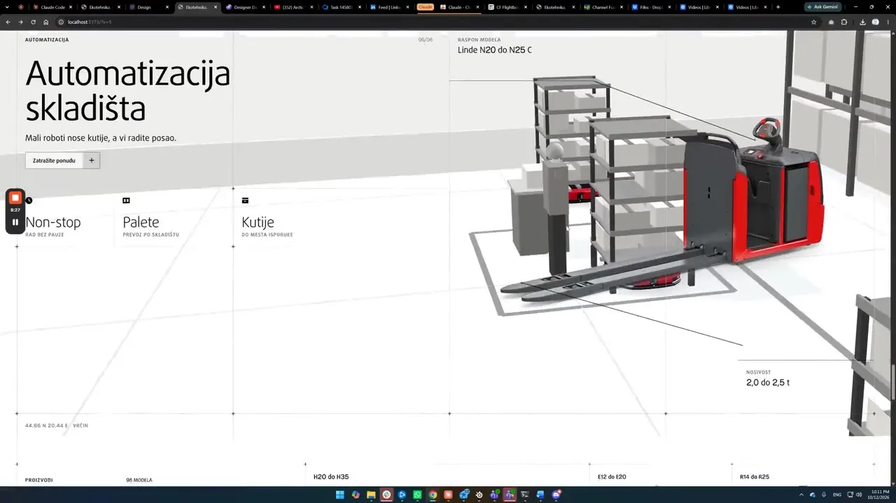

- **Fix, shelves.** Racks to the level of the A racks, uprights with holes, beams, labelled boxes.
- **Fix, arm.** The arm is cut by the near clip plane or by a shelf. Check which, then keep the arm in front of the shelf at every frame.
- **Files.** `src/story2/scenes/sistem/`, the AT set.

## After the story

### 21. No move from AT into Proizvodi

Filip at 8m30, "here we don't have any transition. Somehow we need to have a transition here."

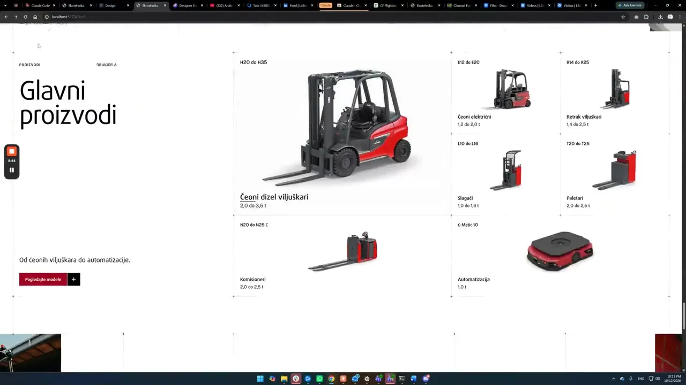

- **Fix.** The grid lines run on from the story into Proizvodi, unbroken, so the page reads as one piece. The story stage scrolls up as one panel and Proizvodi rises under it on the same lines. No fade, per the 5.55pm ruling.
- **Files.** `src/story2/shell/StoryShell.tsx`, `sections.tsx`, `sections.css`.

### 22. Proizvodi needs the text reveal

Filip at 8m55, "we need to have the text reveal as we had for all of these".

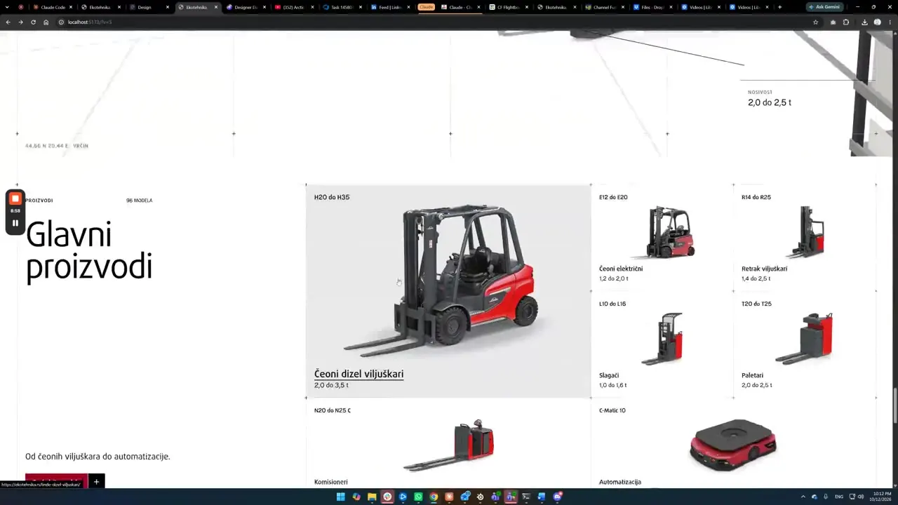

- **Fix.** The same block wipe and letter fill the beats use, started when each block enters the screen, since this section sits after the story clock. Same on the closing section and the footer headline.
- **Files.** `src/story2/shell/sections.tsx`, `sections.css`.

### 23. The closing section keeps only the primary

Filip at 9m05, "we don't need these two buttons here. We just need this one."

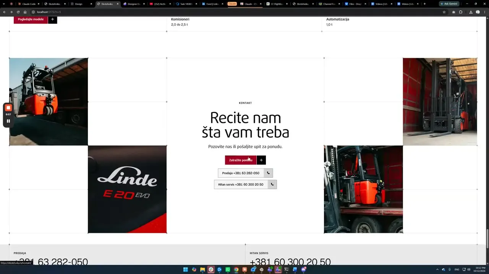

- **Fix.** The two phone buttons go, Zatražite ponudu stays.
- **Files.** `src/story2/shell/sections.tsx`.

## A

### 24. The blue mast reads as CorelDRAW colouring

Filip at 9m15, "I don't like the coloring here for this. This seems like CorelDRAW coloring. Please fix this."

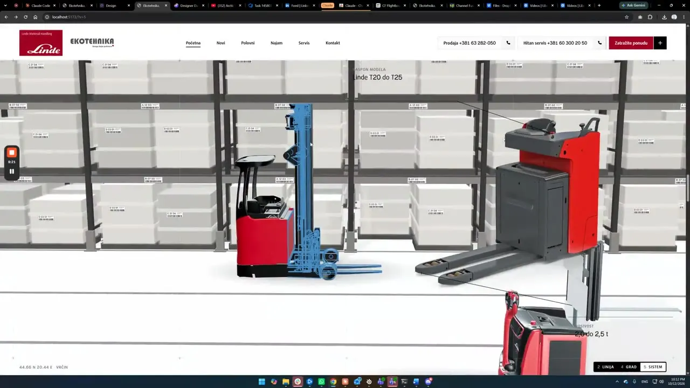

- **Cause, confirmed in code.** `WireTruck` in `sistem/warehouse.tsx` draws every hard edge of the R16 in info blue `#468cc4`, with depth test off, so the back edges draw through the front ones and the mast turns into a solid blue mesh.
- **Fix.** Ink lines at 60 percent, depth tested so only the visible edges draw, silhouette and key edges only, per the 11.50am schematic ruling. The draw on and draw off move stays.
- **Files.** `src/story2/scenes/sistem/warehouse.tsx`.

## The bar for every render

### 25. The rack boxes

Filip at 9m29, "you see how these boxes have things attached to them? This is really cool. Those are the type of details and level of polish I'm expecting on the rest of the renders."

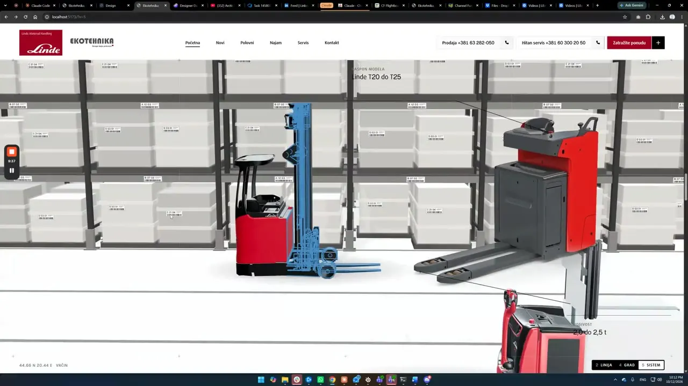

- Logged in `taste.md` as the bar for items 3, 7, 15 and 20.

## Branches

Per Filip, one off branch per 3D scene, each built by its own cloud session, each merged into `claude/awesome-faraday-lkhnn2` by me after its shots and the budget check. No file is owned by two branches.

| Branch | Items | Files it owns |
|---|---|---|
| `claude/awesome-faraday-lkhnn2-street` | 2 scene part, 3, 4, 7 modules, 9 edge, then the footer scenery still per Q11 | `props.tsx`, `outdoor.tsx`, `yard.tsx`, `index.tsx`, `public/footer/` |
| `claude/awesome-faraday-lkhnn2-auto` | 20 | `aisle.tsx`, `atplan.ts`, `grid.tsx` |
| `claude/awesome-faraday-lkhnn2-lift` | 16 | the fork tine in `overlay.tsx` only |
| `claude/awesome-faraday-lkhnn2-servis` | 15, per Q10 | `schematic.tsx`, `bake.ts` |
| `claude/awesome-faraday-lkhnn2-grad` | Grad round 3, F5 to F9 | `src/story2/scenes/grad/` |
| `claude/awesome-faraday-lkhnn2`, here | everything in the shell and `src/ui`, plus 7 scroll, 8 camera, 17, 24 | `src/story2/shell/`, `src/ui/`, `camera.tsx`, `warehouse.tsx`, the band lines in `overlay.tsx`, `kit.ts`, `route.ts` |

Resume check-ins, per the Sessions rule in the README. Each fires hourly at minute 34 into its own session and is deleted when its branch is merged. This session `trig_01BUFDXLPptijwxGrxN3mscL`, street `trig_01E4YcZnYUoN7MpmQATxMYe9`, automation `trig_01CgcqYubTLtP5cUJi1KRThD`, lift `trig_01BtbFadMSpBgWgZ5VuRv9xw`, servis `trig_01Tbd7f6NtEeZAXkZLcNVLUs` (session `session_01NV8EXBSpqoYkmfpLjBXXec`, at minute 38).

## Order of work

Shell work runs here beside the branches.

1. **Batch A, defects and small fixes.** Items 14, 17, 1, 5, 6, 13, 23 and 24. Then the real scroll shot script. Then preview 2, and that is the link for your ship line.
2. **Batch B, beat layouts.** Items 8, 9 list, 11, 12, 18, 21 and 22. Shell builder.
3. **Batch C, motion.** Items 2, 7 scroll and 16, after Q2 and Q4.
4. **Batch D, renders.** Items 3, 4, 7 modules, 9 edge, 15 and 20 on the branches above, beside B and C.
5. **Batch E, nav.** Item 19 in words first, per Q3, then built.
6. **Grad merge.** After Q7, its F5 to F9 fixes, then I merge its branch.
7. **Preview 3** with B to E, `/uireview` on it, then your ship line.

The 1920 board reshoot from round 3 rides on preview 2.

## Done means

- No open sev 1 on the `/uireview` card for preview 3.
- The real scroll script shows no layer from one beat on another beat, in 2, 4 and 5.
- Load numbers at or under the Q6 budget.
- You have opened preview 2 and preview 3 and given a ship line for each.
